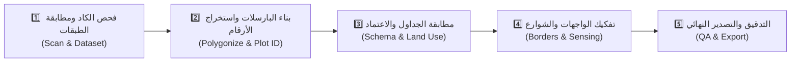

# CAD2GIS — Cadastral Transformation Solution 📐🗺️
**أداة التحويل الكاداسترالي الذكية للمخططات المساحية من CAD إلى GIS (ArcGIS Pro Add-In)**

[](https://pro.arcgis.com/)
[](https://dotnet.microsoft.com/)
[](https://pro.arcgis.com/)
[](https://dotnet.microsoft.com/)
[]()
[]()

---

## 📌 نبذة عن المشروع (Project Overview)

**CAD2GIS** هو امتداد احترافي (ArcGIS Pro Add-in) تم تطويره لأتمتة تحويل المخططات المساحية والتنظيمية من صيغ أوتوكاد (`.dwg` / `.dxf`) إلى قاعدة بيانات جغرافية (`File Geodatabase`) مطابقة للمخطط الهيكلي والاشتراطات البلدية المعتمدة (MOMRAH / بلدي).

تتجاوز الأداة التحويل الهندسي البسيط؛ حيث تدمج خوارزميات متقدمة لمعالجة المنحنيات الحقيقية (True Curves)، المطابقة المكانية ثنائية الأبعاد (2D Spatial Grid Indexing)، استشعار المجاورات والشوارع عبر أشعة ثلاثية (Outward Ray Sensing)، وفحص الجودة الآلي (Automated QA Validation).

---

## 🚀 المراحل الخمس لسير العمل (The 5-Step Pipeline)



### 1️⃣ الخطوة الأولى: فحص ومطابقة طبقات الكاد (Scan & Layer Matching)
- **إنشاء مجلد المخرجات تلقائياً:** التحقق التلقائي من وجود مجلد `Export_Output` وإنشاؤه فورياً في حال عدم وجوده لمنع أي توقف لأدوات التحويل.
- **فهرسة وتصنيف الطبقات:** قراءة طبقات الرسم الفعلية من ملف الكاد وتصنيفها آلياً حسب أدوارها (`Boundary`, `PlotText`, `UsageText`, `Roads`, `Ignore`).
- **تحديد طبقة أرقام القطع (`PlotText`):** إمكانية اختيار طبقة أرقام القطع من القائمة المنسدلة أو تحديدها في الجدول.
- **تحديد طبقات نصوص الاستخدام (`UsageText`):** دعم تحديد أكثر من طبقة في الكاد لاستخدامها كنصوص للأنشطة والاستعمالات.
- **تحديد استعمال الطبقة (`USAGE`):** إضافة قائمة منسدلة اختيارية لكل طبقة لتحديد كود الاستخدام المعتمد (`RSD`, `COM`, `RSC`, `AGR`, `IND`, `UTL`) مقروءاً ومحدثاً مباشرة من جدول `Usage Types`.
- **دعم أوضاع هندسية متعددة للطبقات:**
  - مضلعات كاد مغلقة (`Polygon`).
  - خطوط (`Line`).
  - **خطوط مع طبقة البيانات (`Line with data layer`):** بناء المضلعات وحساب الطبقة السائدة (Dominant Layer) طولياً لكل قطعة وتوريث استعمالها وتصنيفها.

### 2️⃣ الخطوة الثانية: بناء المضلعات واستخراج أرقام القطع (Extract Parcels)
- **بناء مضلعات القطع:** مع الحفاظ على الأقواس والمنحنيات الطبيعية بدون تكسير (`Curve-preserving ring assembly`).
- **تنظيف هندسي ثنائي الأبعاد مستوٍ (`Clean2DPlanar`):** للتخلص من التشوهات وفروق المناسيب وZ/M.
- **استخراج `PLOT_ID` بالربط المكاني (Spatial Join):**
  - ربط مكاني لنصوص طبقة `PlotText` المختارة في الخطوة الأولى الواقعة داخل حدود كل مضلع.
  - دعم بحث جواري ذكي (Proximity Matching حتى 20 متراً) للقطع ذات الأرقام الخارجية أو المحاذية للحدود.
- **تحديد `USAGE` من تصنيف الطبقة:**
  - في نمط `Polygon`: أخذ الاستخدام مباشرة من تصنيف الطبقة المحددة في الخطوة الأولى (`SelectedUsage` أو الكلمات الدلالية أو `UTL` للخدمات).
  - في نمط `Line with data layer`: أخذ الاستخدام من الطبقة السائدة للحدود المجمعة عبر محرك [`DominantLayerMatcher`](file:///d:/workking%20on/shafik/create%20tool%2002/Cad2Gis/Cad2Gis.Core/Services/DominantLayerMatcher.cs).
- **استخراج `REMARKS` بالربط المكاني (Spatial Join):**
  - أخذ الملاحظات ونصوص الأنشطة مكانياً من الطبقة (أو الطبقات المتعددة) المختارة كـ `UsageText` في الخطوة الأولى الواقعة داخل المضلع.
- إنتاج طبقة القطع الأساسية: `Cad_Constructed_Parcels`.

### 3️⃣ الخطوة الثالثة: مطابقة المخطط واستخدامات الأراضي (Apply Schema & Land Use)
- **الأولوية المطلقة لملف الإكسل:**
  - في حال توفر ملف إكسل استخدامات الأراضي (`PARCEs_landuse.xlsx` أو بيانات مخصصة) ووجود تطابق مع `PLOT_ID`:
    $$\text{Excel USAGE} \gg \text{CAD Layer USAGE}$$
    $$\text{Excel REMARKS} \gg \text{CAD Spatial Join REMARKS}$$
  - في حال عدم وجود ملف إكسل أو عدم تطابق القطعة: يتم الحفاظ التام والكامل على قيم `USAGE` المشتقة من تصنيف طبقات الكاد، وقيم `REMARKS` المشتقة من نصوص طبقات `UsageText`.
- تطبيق سياسة الحقول الإلزامية والبيانات المفقودة (`MissingDataPolicy`).
- مقارنة واعتماد المساحات مع إكسل المساحات المعتمد بنسب تفاوت محددة.
- إنتاج طبقة المخطط المعتمد: `PARCEL_Approved_Schema`.

### 4️⃣ الخطوة الرابعة: استشعار الواجهات وتفكيك الحدود (Cardinal Borders & Sensing)
- تفكيك حدود كل قطعة إلى أضلاعها الجغرافية الأصلية (`East`, `West`, `North`, `South`).
- حساب انحراف الشمال الحقيقي (`True North Correction`) بالاعتماد على إسقاط UTM المحلي وزاوية التقارب الزوالي (`Grid Convergence`).
- دمج الشطرات (Chamfers) المجاورة تلقائياً مع الحدود الأقرب.
- **خوارزمية الاستشعار السريع (Outward Ray Sensor):**
  - فحص المجاورات عبر فهرس مكاني شبكي موحد (`SpatialGrid2D`) للوصول لأداء فائق $O(N \log N)$.
  - استشعار نوع الحد (`BORDERTYPE`): جار (قطعة مجاورة)، شارع (مع استنتاج اسم وعرض الشارع)، ممر، أو حديقة بالاعتماد على سمات القطع المجاورة.
- إنتاج طبقة الحدود المعتمدة: `BORDER_Cardinal_Approved`.

### 5️⃣ الخطوة الخامسة: الفحص والاعتماد والتصدير (QA Validation & Export)
- **محرك التدقيق الآلي (QA Validation Engine):**
  - فحص تطابق المساحات وأطوال الحدود وإغلاق المضلعات.
  - فحص الحقول الفارغة والتكرارات وصحة أكواد البلديات.
  - منع تسرب أي نصوص مؤقتة إلى حقل الملاحظات.
- تصدير تقرير فحص الجودة الشامل بصيغة PDF و Excel.
- تصدير الطبقات النهائية بملفات شيب فايل (`Shapefiles`) وقاعدة بيانات جغرافية (`GDB`) مع الحفاظ على الأقواس الحقيقية (`Native True Curves`).

---

## 🏗️ هيكلية المشروع (Architecture)

ينقسم المشروع إلى ثلاث طبقات رئيسية مفصولة معمارياً لضمان قابلية الاختبار والصيانة:

```
Cad2Gis/
├── Cad2Gis.Core/              # مكتبة الفئات الأساسية (خوارزميات نقية، مستقلة عن ArcGIS Pro)
│   ├── Geometry/             # الخوارزميات الهندسية، الفهرسة المكانية، الأقواس والشبكات
│   │   ├── SpatialGrid2D.cs
│   │   └── CurvePreservingPolygonizerService.cs
│   ├── Lookups/              # القواميس وجداول الكلمات الدلالية والأكواد البلدية
│   ├── Models/               # نماذج البيانات (ParcelRecord, BorderRecord, CadLayerInfo...)
│   └── Services/             # المحركات والخدمات (PlotId, LandUse, DominantLayer, QA Engine)
│
├── Cad2Gis.AddIn/             # امتداد ArcGIS Pro (C# / Pro SDK 3.x / WPF XAML)
│   ├── DockPane/             # لوحة التحكم وواجهة المستخدم التفاعلية (MVVM)
│   ├── Geometry/             # المعالجة المتقدمة لأشعة الاستشعار (OutwardRaySensor)
│   ├── IO/                   # إدارة الجيوداتابيز والـ Feature Classes والتصدير
│   └── SpatialEnrichment/    # الإثراء المكاني وربط البيانات
│
└── Cad2Gis.Tests/             # اختبارات الوحدة والتكامل (xUnit)
    ├── CadExtractionAndExpectedLayersTests.cs
    ├── GeometryAndBorderValidationTests.cs
    └── PerformanceAndReviewFixesTests.cs (225 اختبار ناجح)
```

---

## 💻 متطلبات التشغيل (Prerequisites)

- **نظام التشغيل:** Windows 10 / 11 (x64)
- **بيئة ArcGIS Pro:** ArcGIS Pro 3.0 أو أحدث (مع رخصة Standard أو Advanced)
- **بيئة التطوير والتجميع:**
  - .NET 8.0 SDK
  - Visual Studio 2022 مع أدوات `ArcGIS Pro SDK for .NET`

---

## 📦 التثبيت السريع (Quick Installation)

إذا كنت ترغب في استخدام الأداة مباشرة داخل ArcGIS Pro:

1. حمّل ملف الحزمة المجمعة مباشرة من المستودع:
   - [`Cad2Gis.esriAddinX`](https://github.com/aboelmagd1/cad2gis-cadastral/raw/main/Cad2Gis.esriAddinX)
2. أغلق ArcGIS Pro تماماً.
3. انقر نقراً مزدوجاً (Double Click) على ملف `Cad2Gis.esriAddinX`.
4. اضغط على **Install Add-In**.
5. افتح ArcGIS Pro؛ ستجد تبويب **CAD2GIS** متاحاً في الشريط العلوي، واضغط على **Open Cad2Gis Dockpane**.

---

## 🛠️ البناء من المصدر (Building from Source)

لبناء المشروع محلياً وإنشاء حزمة الـ Add-in:

```powershell
# 1. استنساخ المستودع
git clone https://github.com/aboelmagd1/cad2gis-cadastral.git
cd cad2gis-cadastral

# 2. تشغيل اختبارات الوحدة (تتحقق من كافة الخوارزميات بدون الحاجة لـ Pro SDK)
dotnet test "Cad2Gis/Cad2Gis.Tests/Cad2Gis.Tests.csproj"

# 3. تجميع الحزمة وحزم الـ Add-in عبر السكربت التلقائي
powershell -ExecutionPolicy Bypass -File "Cad2Gis/package_addin.ps1"
```

سيتولد ملف `Cad2Gis.esriAddinX` الجديد داخل مجلد `Cad2Gis/bin/Package/` وفي المجلد الرئيسي للمشروع.

---

## 🧪 الاختبارات الآلية (Quality & Testing)

يحتوي المستودع على جناح اختبارات شامل يغطي:
- أداء وكفاءة الفهرس المكاني `SpatialGrid2D`.
- استخراج `PLOT_ID` بأولوياته الدقيقة وحالات الجوار.
- قواعد تصنيف الاستخدامات (`LandUseExcelService`) والواجهات المعتمدة.
- حفظ وتحميل البروفايلات وإكسل الطبقات المتوقعة.

لتشغيل الاختبارات:
```powershell
dotnet test
```
```text
Passed!  - Failed: 0, Passed: 225, Skipped: 0, Total: 225, Duration: 2.1 s
```

---

## 📄 الترخيص (License)

هذا المشروع مخصص للاستخدام الهندسي والمساحي الاحترافي. جميع الحقوق محفوظة لفرق التطوير والعمل المساحي.
