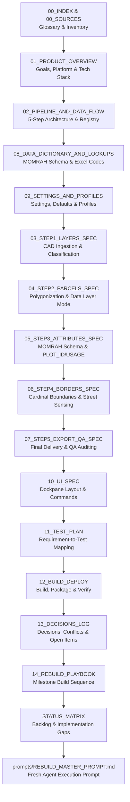

# CAD2GIS — Master Specification Index & Cadastral Glossary (00_INDEX.md)

> **الملخص التنفيذي بالعربية:**
> يُعد هذا الملف الدليل الإرشادي وخريطة القراءة المنظمة لكامل مجموعة مواصفات نظام CAD2GIS. يحتوي على التسلسل المعتمد لقراءة الوثائق للمطور أو الوكيل البرمجي (Reading Order)، بالإضافة إلى قاموس هندسي ومصطلحي دقيق (Glossary) يُعرّف المفاهيم المساحية الأساسية مثل القطع الرئيسية والفرعية، الحدود الجغرافية، الأجزاء المشتركة، المنحنيات الحقيقية، والأنظمة الإحداثية وفق معايير وزارة البلديات والإسكان السعودية (MOMRAH).

---

## 1. Specification Reading Order

To rebuild the system or understand its end-to-end architecture from a cold start, read the specification set in this exact sequence:

1. [00_INDEX.md](00_INDEX.md) & [00_SOURCES.md](00_SOURCES.md) — Fundamental terminology, sources directory, transformation map.
2. [01_PRODUCT_OVERVIEW.md](01_PRODUCT_OVERVIEW.md) — High-level goals, Saudi municipal context, platform stack, folder structure.
3. [02_PIPELINE_AND_DATA_FLOW.md](02_PIPELINE_AND_DATA_FLOW.md) — 5-step pipeline invariants, single-copy disk model, registry state engine.
4. [08_DATA_DICTIONARY_AND_LOOKUPS.md](08_DATA_DICTIONARY_AND_LOOKUPS.md) — 26 parcel fields, 10 border fields, 68 border types, 6 usage codes.
5. [09_SETTINGS_AND_PROFILES.md](09_SETTINGS_AND_PROFILES.md) — All system configuration parameters, defaults, and multi-profile schema.
6. [03_STEP1_LAYERS_SPEC.md](03_STEP1_LAYERS_SPEC.md) — CAD reading, `Cad_Dataset` feature classes, 5 tab categories, xArab decoder.
7. [04_STEP2_PARCELS_SPEC.md](04_STEP2_PARCELS_SPEC.md) — Polygonization modes (Line, Polygon, Line with data layer), text joins.
8. [05_STEP3_ATTRIBUTES_SPEC.md](05_STEP3_ATTRIBUTES_SPEC.md) — MOMRAH schema attribution, `PLOT_ID` from `PLOT_TXT`, USAGE precedence.
9. [06_STEP4_BORDERS_SPEC.md](06_STEP4_BORDERS_SPEC.md) — Cardinal boundary extraction (10°–160°), shared segment sensing, single ray width.
10. [07_STEP5_EXPORT_QA_SPEC.md](07_STEP5_EXPORT_QA_SPEC.md) — Deliverable structure (`Final/Final.gdb`, `Shape`, `Reports`), QA validation.
11. [10_UI_SPEC.md](10_UI_SPEC.md) — Modern slate dockpane MVVM layout, button commands, bilingual string catalog.
12. [11_TEST_PLAN.md](11_TEST_PLAN.md) — Requirements traceability test matrix, fixtures, standalone vs ArcGIS Pro testing.
13. [12_BUILD_DEPLOY.md](12_BUILD_DEPLOY.md) — Visual Studio build instructions, packaging, no auto-install rule.
14. [13_DECISIONS_LOG.md](13_DECISIONS_LOG.md) — Register of owner decisions (D01–D20), conflict resolutions, OPEN items.
15. [14_REBUILD_PLAYBOOK.md](14_REBUILD_PLAYBOOK.md) — Step-by-step rebuild milestones (M1–M8) and acceptance gates.
16. [STATUS_MATRIX.md](STATUS_MATRIX.md) — Verification status of every requirement against current workspace code.
17. [REBUILD_MASTER_PROMPT.md](../REBUILD_MASTER_PROMPT.md) — Single prompt for a fresh AI agent to rebuild the solution.

---

## 2. Cadastral & Architectural Glossary

### 2.1 Cadastral Domain Concepts

| Term | Arabic Equivalent | Definition & Technical Rule |
| :--- | :--- | :--- |
| **Parcel** | قطعة أرض | A 2D planar polygon representing an individual property unit or public amenity with closed boundary topology and attributes. |
| **MAIN Parcel** | قطعة رئيسية | A private residential, commercial, or investment property parcel (`PARCEL_TYP = 1`, internal class `ParcelClass.Main`). Receives an assigned `PLOT_ID`, undergoes 4-cardinal facade decomposition in Step 4, and is audited for duplicate IDs. |
| **SUB Parcel** | قطعة فرعية / خدمات | A public facility, utility, mosque, park, electrical substation, walkway, or roadway (`PARCEL_TYP = 2`, internal class `ParcelClass.Sub`). Default `USAGE = UTL`. Does NOT undergo border decomposition in Step 4, but serves as a neighbour to MAIN parcels. |
| **Border (Boundary)** | حد القطعة | A single-part polyline representing the exterior boundary of a MAIN parcel facing a single cardinal direction (North, East, South, West). At most 4 lines per ring. |
| **Facade** | واجهة | The exterior side of a parcel facing a street, passage, or adjacent parcel. |
| **Shared Segment** | الجزء المشترك | The contiguous portion of a parcel boundary line that touches or is coincident with an adjoining neighbour parcel boundary (length $\ge 0.5\text{ m}$ within a $0.05\text{ m}$ buffer tolerance). Used to assign `BORDERTYPE = PLT` or sub-parcel types. |
| **Exterior Ring** | الحلقة الخارجية | The primary closed boundary loop defining the outer perimeter of a polygon. Vertices ordered clockwise. |
| **Interior Ring (Hole)** | حلقة داخلية / ثقب | A closed boundary loop inside a parcel representing an excluded interior courtyard, lightwell, or cutout. Vertices ordered counter-clockwise. Each hole is processed independently in Step 4. |
| **Chamfer ("Shotar")** | شطرة / زاوية مشطوفة | A short transitional boundary segment connecting two perpendicular facades (typically at street intersections). Handled via corner clustering ($L \le 7\text{ m}$) so it does not distort cardinal direction assignment. |
| **Meridian Convergence** | زاوية تقارب خطوط الزوال | The angular difference between Grid North in a projected UTM coordinate system and True Geographic North. Calculated at the parcel centroid to correct facade azimuths. |
| **Outward Normal** | العمودي المتجه للخارج | A vector perpendicular to a boundary segment pointing away from the parcel interior (or pointing into a hole for interior rings). Used to determine cardinal orientation and ray casting direction. |

---

### 2.2 System & Technical Concepts

| Term | Arabic Equivalent | Definition & Technical Rule |
| :--- | :--- | :--- |
| **Single Source of Truth (SSOT)** | المصدر المعتمد الوحيد | The local workspace files (`Cad2Gis/`, `HelperFiles/`, `prompts/`). No reliance on external uncommitted copies or in-memory session duplicates. |
| **Single Output on Disk** | نسخة وحيدة على القرص | Each pipeline step produces exactly ONE verified feature class on disk. The output *is* the working data and export. There is no separate "live in-memory" copy versus "exported" copy. |
| **Pipeline Registry** | سجل مسار المعالجة | The persistent JSON file (`HelperFiles/state/pipeline_state.json`) tracking the verified output path, feature count, WKID, and content stamp of each step. |
| **Content Stamp** | بصمة المحتوى | A cryptographic hash or feature-level edit signature computed from the geometries and attributes of a feature class, used to detect whether manual edits occurred in ArcGIS Pro. |
| **Working Fields** | الحقول التشغيلية | Intermediate attributes written by Step 2 (`SRC_LAYER`, `SRC_LAYERS`, `PARCEL_CLS`, `PLOT_TXT`, `PLOT_LYR`, `USAGE_TXT`, `USAGE_LYR`, `LYR_USAGE`, `MATCH_MODE`, `PROV`). They are strictly dropped from the final MOMRAH schema in Step 3. |
| **Frozen Metrics** | المقاييس المجمدة | Geometric measurements (`AREA_SQM`, `Shape_Area`, `Shape_Leng`, `DIMENSION`) computed analytically from native true curves in projected UTM meters and stored as static attributes before shapefile export. |
| **Controlled Densification** | التخشين المنضبط | The process of approximating true circular arcs into discrete line vertices during shapefile export (because Shapefile format does not support mathematical curves), strictly constrained to a maximum deflection deviation $\le 0.001\text{ m}$ (1 millimeter). |
| **True Curves (Native Arcs)** | المنحنيات الحقيقية | Mathematical arc representations (`EllipticArcSegment`, `CubicBezierSegment`) stored in Geodatabase feature classes with preserved center, radius, and curvature without chord segmentation (INV-01). |
| **2D Planar Geometry** | هندسة مسطحة ثنائية الأبعاد | Geometric coordinates containing only $X$ and $Y$ values, with elevation ($Z$) and measurement ($M$) metadata completely stripped (`HasZ = false; HasM = false`) for MOMRAH/Balady compliance (INV-05). |
| **Anti-Freeze Threading** | معمارية منع تجمد الواجهة | The execution model where long-running geoprocessing and analytical calculations run asynchronously off the UI thread, while Pro SDK geometry modifications execute inside `QueuedTask.Run` (INV-08). |
| **No Auto-Install Policy** | سياسة التثبيت اليدوي | The packaging rule stipulating that `package_addin.ps1` must never automatically copy `.esriAddinX` to the user's ArcGIS Pro system directory (`%USERPROFILE%\Documents\ArcGIS\AddIns\...`). The user installs manually (INV-04). |
