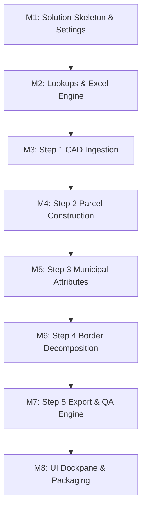

# CAD2GIS Specification — Document 14: Rebuild Playbook and Traceability

> **ملخص باللغة العربية (Arabic Summary):**  
> يمثل هذا الدليل خطة العمل المعيارية والخطوات المتسلسلة (Milestones M1 إلى M8) لإعادة بناء وتطوير منصة CAD2GIS من الصفر بواسطة أي مطور أو نموذج ذكاء اصطناعي مستقل. يقدم الدليل معايير القبول الصارمة لكل مرحلة، مع مصفوفة التتبع الشاملة التي تربط كل متطلب (REQ) بملف المواصفات المقابل وموقعه في الكود واختبار الوحدة (Unit Test) الذي يضمن صحته قبل الانتقال للمرحلة التالية.

---

## 1. Rebuild Execution Milestones

### Milestone M1: Solution Skeleton & Configuration Infrastructure
- **Objective:** Establish the .NET 8 solution, three-tier project architecture, and profile/settings storage.
- **Components to Build:**
  - `Cad2Gis.sln`, `Cad2Gis.Core.csproj` (`net8.0`), `Cad2Gis.AddIn.csproj` (`net8.0-windows`), `Cad2Gis.Tests.csproj` (`net8.0`).
  - Core models: `SettingsModel`, `ConsultantProfileModel`, `CoordinateSystemInfo`.
  - Storage service: `SettingsManager` (read/write `%APPDATA%/CAD2GIS/settings.json`, self-healing defaults).
- **Acceptance Criteria:**
  - Solution builds cleanly with 0 errors via `dotnet build Cad2Gis.sln`.
  - `SettingsManager` tests pass: default settings generated on empty path; backward-compatible JSON migration verified.

---

### Milestone M2: Lookups, Excel Engine, and Template Services
- **Objective:** Enable runtime parsing of municipal schemas and lookup tables without hard-coded lists.
- **Components to Build:**
  - `ClosedXmlService`: Read `Required Fields in the Shapefile.xlsx` (`Usage Types`, `Border Types`, `Building Types`).
  - `LookupService`: Caching of code lists, `BorderType_Keywords.csv`, `Usage_Keywords.csv`, `standard_widths.json`.
  - `TemplateFeatureService`: Parsing reference schema fields and lengths from template shapefiles.
- **Acceptance Criteria:**
  - Unit tests verify extraction of 6 USAGE types (`RSD, COM, RSC, AGR, IND, UTL`).
  - Keyword lookup matches Arabic strings (e.g., `"مسجد"` $\rightarrow$ `MSQ`).
  - Missing Excel file triggers graceful self-healing bootstrap from embedded resources.

---

### Milestone M3: Step 1 CAD Ingestion and Font Decoding
- **Objective:** Ingest DWG/DXF layers into `Cad_Dataset`, apply category tabs, and decode reversed CAD text.
- **Components to Build:**
  - `CadDatasetReader`: CAD feature class inspection (`Polyline`, `Polygon`, `Annotation`, `Point`).
  - `ArabicTextDecoder`: xArab reverse-byte font decoding with slash preservation (`11/3314`).
  - `LayerCategorizationService`: Assign CAD layers to `[Main Parcels]`, `[Sub-Parcels]`, `[Text & Annotations]`, `[Ignore]`.
  - `ExpectedLayersService`: Auto-mapping CAD layers from `Expected_Layers.xlsx`; generating `Layers_Used.xlsx`.
- **Acceptance Criteria:**
  - Unit tests confirm xArab strings decode correctly to readable Arabic without reversing numeric slash numbers.
  - Layer assignment correctly routes street linework into `[Sub-Parcels]`.

---

### Milestone M4: Step 2 Parcel Polygonization Engine
- **Objective:** Construct clean 2D parcel polygons from linework or native polygons with spatial text joins.
- **Components to Build:**
  - `GeometryEngine2D`: Planar polygon construction, intersection graphs, hole assignment.
  - Three geometry modes:
    - `Line`: Combined multi-layer linework $\rightarrow$ polygons.
    - `Polygon`: Direct ingestion and boundary validation.
    - `Line with data layer`: Split lines at vertices, $0.05\text{ m}$ buffer, 60% dominant length classification (`_CLASS`, `_LAYER`, `_DOM_PCT`).
  - Spatial text joiner: Point-in-polygon containment, nearest fallback within search radius, conflict flag `MIXED_LABELS`.
- **Acceptance Criteria:**
  - `Fixture_LineWithDataLayer` test achieves 100% dominant attribution for test boundaries.
  - Spatial text join attaches `PLOT_TXT` and `USAGE_TXT` with exact provisional `P{ID}` fallbacks.
  - Output feature class `Cad_Constructed_Parcels` written with all 10 working fields.

---

### Milestone M5: Step 3 Municipal Attribute and Schema Population
- **Objective:** Map provisional CAD parcels to official MOMRAH 26-field cadastral schema.
- **Components to Build:**
  - `Step3MunicipalSchemaService`: Field definition enforcement from template.
  - `PLOT_ID` ingestion logic: In Line with data layer mode, pull from Step 2 `PLOT_TXT` (trimming, digit/slash guard).
  - 4-Tier `USAGE` precedence resolver: Manual $\rightarrow$ Excel $\rightarrow$ Layer USAGE $\rightarrow$ Fallback (`SUB` $\rightarrow$ `UTL`).
  - `REMARKS` generator: Usage text $\rightarrow$ USAGE $\rightarrow$ Empty (prohibiting `PlotId` or provenance).
  - `AdminAreaDetector`: Point-in-polygon spatial overlay with administrative boundaries shapefile.
  - Working field purging: Completely strip internal temporary fields from final output.
- **Acceptance Criteria:**
  - Step 3 unit tests pass with zero working fields remaining in `PARCEL_Approved_Schema`.
  - Ingestion of `PLOT_TXT = " 45/أ "` correctly normalizes to `"45/أ"`.
  - Land-use classification strictly adheres to official 6-code vocabulary.

---

### Milestone M6: Step 4 Cardinal Border Extraction Engine
- **Objective:** Deconstruct MAIN parcel boundaries into 4 cardinal facades with street width and neighbor sensing.
- **Components to Build:**
  - `BorderDecompositionEngine`: Split rings by interior angles ($[10^\circ, 160^\circ]$ and $[200^\circ, 350^\circ]$), arc virtual chord evaluation, $7\text{ m}$ corner cluster merging.
  - Cardinal classifier: Outward normal azimuth, true north meridian convergence correction, assignment to 1 North, 2 East, 3 South, 4 West.
  - Shared segment analyzer: $0.05\text{ m}$ coincidence buffer, $\ge 0.5\text{ m}$ length threshold, neighbor classification (`PLT` vs SUB keyword match).
  - Street width sensor: Single perpendicular midpoint ray ($1.0\text{ m}$ to $100.0\text{ m}$ obstacle facing distance), passage vs street threshold ($10.0\text{ m}$).
  - `DIMENSION` evaluator: Single vs Multi based on $15^\circ$ deflection threshold.
- **Acceptance Criteria:**
  - Rectangular fixture (`FIX-RECT-01`) produces exactly 4 borders with directions 1, 2, 3, 4.
  - Chamfered corner fixture (`FIX-CHAMF-02`) merges corner segments into dominant facades via $7\text{ m}$ rule.
  - Shared party wall correctly receives `BORDERTYPE = 'PLT'`.
  - Street width accurately measures $15.0\text{ m}$ facing gap and classifies as street (`ST`).

---

### Milestone M7: Step 5 Export Packaging and QA Engine
- **Objective:** Produce final delivery packages in native FileGDB and Shapefile formats with rigorous QA audits.
- **Components to Build:**
  - `ExportPackagingService`: Write `Final.gdb` (native arcs) and `Final/Shape/` (controlled densification $\le 0.001\text{ m}$).
  - GCS Transformer: Reproject copies to WGS 84 (EPSG 4326) while freezing metric fields (`PARCEL_ARE`, `LENGTH_M`).
  - DBF string validator: Ensure text fits within byte limits in UTF-8 encoding.
  - `QaValidationEngine`: Execute all 8 municipal validation rules (geometry, schema, missing data, bounds).
  - Reporting: Output bilingual `QA_Audit_Summary.json` and human-readable `.txt`.
- **Acceptance Criteria:**
  - Shapefile export passes DBF byte length checks without truncation.
  - Exported shapefile directory contains mandatory UTF-8 `.cpg` files.
  - QA validator detects and reports synthetic errors (e.g., unassigned `PARCEL_NO`).

---

### Milestone M8: UI Dockpane, Anti-Freeze Integration, and Packaging
- **Objective:** Construct WPF dockpane, integrate viewmodels with thread safety, and assemble release `.esriAddinX`.
- **Components to Build:**
  - `Cad2GisDockpane.xaml` and ViewModels (`Cad2GisDockpaneViewModel.Step1..5.cs`).
  - Progress console, review DataGrids, and bilingual status banners.
  - Anti-freeze dispatcher: Wrap geoprocessing calls in `QueuedTask.Run` with background worker isolation.
  - `package_addin.ps1`: Automated packaging script assembling `.esriAddinX`.
- **Acceptance Criteria:**
  - UI remains fully responsive during Step 4 execution on a 1,000-parcel dataset.
  - `.esriAddinX` installs successfully via Esri utility and ribbon button opens dockpane cleanly.

---

## 2. Master Requirement Traceability Matrix

| Requirement ID | Spec Document | Target Implementation Class / Location | Verifying Unit / Integration Test |
| :--- | :--- | :--- | :--- |
| `REQ-GEN-001` | `01_PRODUCT_OVERVIEW.md` | `Cad2Gis.*.csproj` | Solution build verification |
| `REQ-GEN-002` | `01_PRODUCT_OVERVIEW.md` | `SettingsManager.cs` | `SettingsManagerTests.DefaultCreation` |
| `REQ-GEN-003` | `01_PRODUCT_OVERVIEW.md` | `Cad2Gis_ArcPy.pyt` | Manual ArcPy execution test |
| `REQ-GEN-004` | `01_PRODUCT_OVERVIEW.md` | `Cad2GisDockpaneViewModel.cs` | Code review (No background write) |
| `REQ-GEN-005` | `01_PRODUCT_OVERVIEW.md` | `GeometryEngine2D.cs` | `GeometryPreservationTests.ArcCurvature` |
| `REQ-PIPE-001` | `02_PIPELINE_AND_DATA_FLOW.md` | `Cad2GisDockpaneViewModel.Step*.cs` | Pipeline state sequence tests |
| `REQ-PIPE-002` | `02_PIPELINE_AND_DATA_FLOW.md` | `SourceSelectionViewModel.cs` | `SourceSelectorTests.TwoOptionsOnly` |
| `REQ-PIPE-003` | `02_PIPELINE_AND_DATA_FLOW.md` | `GdbFeatureClassService.cs` | `GdbNamingTests.SingleOutputPerStep` |
| `REQ-PIPE-004` | `02_PIPELINE_AND_DATA_FLOW.md` | `PipelineStateManager.cs` | `PipelineStateTests.JsonPersistence` |
| `REQ-PIPE-005` | `02_PIPELINE_AND_DATA_FLOW.md` | `WorkingFieldService.cs` | `WorkingFieldTests.LifecyclePurge` |
| `REQ-PIPE-006` | `02_PIPELINE_AND_DATA_FLOW.md` | `GdbFeatureClassService.cs` | `ConcurrencyTests.SingleCopyOnDisk` |
| `REQ-PIPE-007` | `02_PIPELINE_AND_DATA_FLOW.md` | `ContentStampService.cs` | `ContentStampTests.Sha256ChangeDetection` |
| `REQ-PIPE-008` | `02_PIPELINE_AND_DATA_FLOW.md` | `Cad2GisDockpaneViewModel.cs` | `ExceptionHandlingTests.ExplicitFailure` |
| `REQ-ST1-001` | `03_STEP1_LAYERS_SPEC.md` | `CadDatasetReader.cs` | `CadReaderTests.IngestFeatureClasses` |
| `REQ-ST1-002` | `03_STEP1_LAYERS_SPEC.md` | `CoordinateSystemService.cs` | `CrsTests.UtmZoneValidation` |
| `REQ-ST1-003` | `03_STEP1_LAYERS_SPEC.md` | `LayerCategorizationService.cs` | `LayerMappingTests.FourCategoryRouting` |
| `REQ-ST1-004` | `03_STEP1_LAYERS_SPEC.md` | `LayerCategorizationService.cs` | `LayerMappingTests.RoadwayInSubCategory` |
| `REQ-ST1-005` | `03_STEP1_LAYERS_SPEC.md` | `Cad2GisDockpaneViewModel.Step1.cs` | `GeometryModeTests.ThreeModesSelectable` |
| `REQ-ST1-006` | `03_STEP1_LAYERS_SPEC.md` | `ClosedXmlService.cs` | `LookupTests.LayerUsageDropdownRefresh` |
| `REQ-ST1-007` | `03_STEP1_LAYERS_SPEC.md` | `ArabicTextDecoder.cs` | `ArabicDecoderTests.XArabSlashPreservation` |
| `REQ-ST1-008` | `03_STEP1_LAYERS_SPEC.md` | `ExpectedLayersService.cs` | `ExcelReportTests.LayersUsedCreation` |
| `REQ-ST2-001` | `04_STEP2_PARCELS_SPEC.md` | `GeometryEngine2D.cs` | `ParcelBuilderTests.LineModePolygonization` |
| `REQ-ST2-002` | `04_STEP2_PARCELS_SPEC.md` | `GeometryEngine2D.cs` | `ParcelBuilderTests.PolygonModeIngestion` |
| `REQ-ST2-003` | `04_STEP2_PARCELS_SPEC.md` | `LineWithDataLayerEngine.cs` | `LineWithDataLayerTests.DominantAttribution` |
| `REQ-ST2-004` | `04_STEP2_PARCELS_SPEC.md` | `SpatialTextJoinEngine.cs` | `TextJoinTests.ContainmentAndNearestFallback` |
| `REQ-ST2-005` | `04_STEP2_PARCELS_SPEC.md` | `SpatialTextJoinEngine.cs` | `TextJoinTests.ConflictMixedLabels` |
| `REQ-ST2-006` | `04_STEP2_PARCELS_SPEC.md` | `SpatialTextJoinEngine.cs` | `TextJoinTests.ProvisionalIdGeneration` |
| `REQ-ST2-007` | `04_STEP2_PARCELS_SPEC.md` | `WorkingFieldService.cs` | `WorkingFieldTests.Populate10WorkingFields` |
| `REQ-ST2-008` | `04_STEP2_PARCELS_SPEC.md` | `TextJoinReportService.cs` | `ReportTests.TextJoinReportGeneration` |
| `REQ-ST2-009` | `04_STEP2_PARCELS_SPEC.md` | `Cad2GisDockpaneViewModel.Step2.cs` | UI error presentation tests |
| `REQ-ST3-001` | `05_STEP3_ATTRIBUTES_SPEC.md` | `Cad2GisDockpaneViewModel.Step3.cs` | `PlotTxtExtractionTests.NormalizeAndPopulate` |
| `REQ-ST3-002` | `05_STEP3_ATTRIBUTES_SPEC.md` | `UsagePrecedenceResolver.cs` | `UsageResolverTests.FourTierPrecedence` |
| `REQ-ST3-003` | `05_STEP3_ATTRIBUTES_SPEC.md` | `UsagePrecedenceResolver.cs` | `UsageResolverTests.StrictOfficialCodesOnly` |
| `REQ-ST3-004` | `05_STEP3_ATTRIBUTES_SPEC.md` | `RemarksGenerator.cs` | `RemarksTests.NoPlotIdOrProvenance` |
| `REQ-ST3-005` | `05_STEP3_ATTRIBUTES_SPEC.md` | `AdminAreaDetector.cs` | `AdminDetectorTests.PointInPolygonOverlay` |
| `REQ-ST3-006` | `05_STEP3_ATTRIBUTES_SPEC.md` | `MissingDataPolicy.cs` | `DataPolicyTests.EmptyPolicyCompliance` |
| `REQ-ST3-007` | `05_STEP3_ATTRIBUTES_SPEC.md` | `TemplateSchemaEnforcer.cs` | `SchemaTests.EnforceMOMRAH26Fields` |
| `REQ-ST3-008` | `05_STEP3_ATTRIBUTES_SPEC.md` | `WorkingFieldService.cs` | `WorkingFieldTests.PurgeAllFromStep3` |
| `REQ-ST3-009` | `05_STEP3_ATTRIBUTES_SPEC.md` | `Step3Tracer.cs` | `AuditTests.TraceLogGeneration` |
| `REQ-ST3-010` | `05_STEP3_ATTRIBUTES_SPEC.md` | `Cad2GisDockpaneViewModel.Step3.cs` | `ProtectionTests.PreserveManualEdits` |
| `REQ-ST4-001` | `06_STEP4_BORDERS_SPEC.md` | `BorderExtractionEngine.cs` | `BorderTests.MainParcelsOnly` |
| `REQ-ST4-002` | `06_STEP4_BORDERS_SPEC.md` | `BorderExtractionEngine.cs` | `BorderTests.IndependentRingsAndHoles` |
| `REQ-ST4-003` | `06_STEP4_BORDERS_SPEC.md` | `BorderExtractionEngine.cs` | `BorderTests.MaxFourSinglePartLines` |
| `REQ-ST4-004` | `06_STEP4_BORDERS_SPEC.md` | `CornerDetector.cs` | `AngleTests.InteriorAngleSplitRange` |
| `REQ-ST4-005` | `06_STEP4_BORDERS_SPEC.md` | `CornerDetector.cs` | `CurveTests.ArcVirtualChordEvaluation` |
| `REQ-ST4-006` | `06_STEP4_BORDERS_SPEC.md` | `CornerClusterEngine.cs` | `ClusterTests.SevenMeterChamferMerge` |
| `REQ-ST4-007` | `06_STEP4_BORDERS_SPEC.md` | `NormalVectorEngine.cs` | `AzimuthTests.OutwardNormalMeridianCorrection` |
| `REQ-ST4-008` | `06_STEP4_BORDERS_SPEC.md` | `FacadeMergeEngine.cs` | `MergeTests.Rule1Rule2Merge` |
| `REQ-ST4-009` | `06_STEP4_BORDERS_SPEC.md` | `GeometryEngine2D.cs` | `GeometryTests.ZeroDeformationInSplitting` |
| `REQ-ST4-010` | `06_STEP4_BORDERS_SPEC.md` | `SharedSegmentAnalyzer.cs` | `NeighborTests.CoincidenceThresholds` |
| `REQ-ST4-011` | `06_STEP4_BORDERS_SPEC.md` | `BorderTypeResolver.cs` | `NeighborTests.MainNeighborIsPlt` |
| `REQ-ST4-012` | `06_STEP4_BORDERS_SPEC.md` | `BorderTypeResolver.cs` | `NeighborTests.SubNeighborKeywordMatch` |
| `REQ-ST4-013` | `06_STEP4_BORDERS_SPEC.md` | `BorderTypeResolver.cs` | `NeighborTests.MultipleNeighborsLongestType` |
| `REQ-ST4-014` | `06_STEP4_BORDERS_SPEC.md` | `DescriptionFormatter.cs` | `DescriptionTests.FormatNeighborsAndStreets` |
| `REQ-ST4-015` | `06_STEP4_BORDERS_SPEC.md` | `StreetWidthSensor.cs` | `WidthSensorTests.SingleRayMidpointFacingGap` |
| `REQ-ST4-016` | `06_STEP4_BORDERS_SPEC.md` | `StreetWidthSensor.cs` | `WidthSensorTests.ThreeRecordedValues` |
| `REQ-ST4-017` | `06_STEP4_BORDERS_SPEC.md` | `StreetWidthSensor.cs` | `WidthSensorTests.PassageStreetThreshold` |
| `REQ-ST4-018` | `06_STEP4_BORDERS_SPEC.md` | `DimensionEvaluator.cs` | `DimensionTests.FifteenDegreeDeflection` |
| `REQ-ST4-019` | `06_STEP4_BORDERS_SPEC.md` | `DescriptionFormatter.cs` | `DbfValidationTests.DescriptionByteCheck` |
| `REQ-ST4-020` | `06_STEP4_BORDERS_SPEC.md` | `BorderSpatialIndex.cs` | `PerformanceTests.EnvelopeSpatialIndex` |
| `REQ-ST5-001` | `07_STEP5_EXPORT_QA_SPEC.md` | `ExportPackagingService.cs` | `ExportTests.FileGdbNativeArcs` |
| `REQ-ST5-002` | `07_STEP5_EXPORT_QA_SPEC.md` | `ExportPackagingService.cs` | `ExportTests.ShapefileControlledDensify` |
| `REQ-ST5-003` | `07_STEP5_EXPORT_QA_SPEC.md` | `ExportPackagingService.cs` | `ExportTests.MandatoryCpgUtf8` |
| `REQ-ST5-004` | `07_STEP5_EXPORT_QA_SPEC.md` | `Cad2GisDockpaneViewModel.Step5.cs` | `MapLayerTests.FourOutputsOnMap` |
| `REQ-ST5-005` | `07_STEP5_EXPORT_QA_SPEC.md` | `GcsExportService.cs` | `GcsExportTests.FreezeMetricAttributes` |
| `REQ-ST5-006` | `07_STEP5_EXPORT_QA_SPEC.md` | `DbfByteValidator.cs` | `DbfValidationTests.Utf8ByteTruncationGuard` |
| `REQ-ST5-007` | `07_STEP5_EXPORT_QA_SPEC.md` | `QaValidationEngine.cs` | `QaAuditTests.AllEightValidationRules` |
| `REQ-ST5-008` | `07_STEP5_EXPORT_QA_SPEC.md` | `QaReportWriter.cs` | `ReportTests.BilingualJsonAndTxtAudit` |
| `REQ-ST5-009` | `07_STEP5_EXPORT_QA_SPEC.md` | `PipelineStateManager.cs` | `PipelineStateTests.CommitOnlyOnSuccess` |
| `REQ-ST5-010` | `07_STEP5_EXPORT_QA_SPEC.md` | `ExportPackagingService.cs` | `ExportTests.DirectoryStructureIntegrity` |
| `REQ-DATA-001` | `08_DATA_DICTIONARY_AND_LOOKUPS.md` | `Required Fields in the Shapefile.xlsx` | `DataDictTests.MOMRAHParcelFields` |
| `REQ-DATA-002` | `08_DATA_DICTIONARY_AND_LOOKUPS.md` | `Required Fields in the Shapefile.xlsx` | `DataDictTests.MOMRAHBorderFields` |
| `REQ-DATA-003` | `08_DATA_DICTIONARY_AND_LOOKUPS.md` | `WorkingFieldService.cs` | `DataDictTests.TenWorkingFields` |
| `REQ-DATA-004` | `08_DATA_DICTIONARY_AND_LOOKUPS.md` | `ClosedXmlService.cs` | `LookupTests.ReadUsageTypesSheet` |
| `REQ-DATA-005` | `08_DATA_DICTIONARY_AND_LOOKUPS.md` | `ClosedXmlService.cs` | `LookupTests.ReadBorderTypesSheet` |
| `REQ-DATA-006` | `08_DATA_DICTIONARY_AND_LOOKUPS.md` | `ClosedXmlService.cs` | `LookupTests.ReadBuildingTypesSheet` |
| `REQ-DATA-007` | `08_DATA_DICTIONARY_AND_LOOKUPS.md` | `ClosedXmlService.cs` | `LookupTests.KeywordTables` |
| `REQ-DATA-008` | `08_DATA_DICTIONARY_AND_LOOKUPS.md` | `CoordinateSystemService.cs` | `CrsTests.UtmCentralMeridians` |
| `REQ-SET-001` | `09_SETTINGS_AND_PROFILES.md` | `SettingsManager.cs` | `SettingsTests.ParameterValidation` |
| `REQ-SET-002` | `09_SETTINGS_AND_PROFILES.md` | `ProfileManager.cs` | `ProfileTests.MultiConsultantProfiles` |
| `REQ-SET-003` | `09_SETTINGS_AND_PROFILES.md` | `ProfileManager.cs` | `ProfileTests.BackwardCompatibility` |
| `REQ-SET-004` | `09_SETTINGS_AND_PROFILES.md` | `HelperFilesDiscoveryService.cs` | `HelperFilesTests.DiscoveryHierarchy` |
| `REQ-SET-005` | `09_SETTINGS_AND_PROFILES.md` | `HelperFilesDiscoveryService.cs` | `HelperFilesTests.SelfHealingBootstrap` |
| `REQ-SET-006` | `09_SETTINGS_AND_PROFILES.md` | `SettingsManager.cs` | `SettingsTests.PersistenceIntegrity` |
| `REQ-UI-001` | `10_UI_SPEC.md` | `Cad2GisDockpane.xaml` | Visual inspection & XAML validation |
| `REQ-UI-002` | `10_UI_SPEC.md` | `Cad2GisDockpaneViewModel.cs` | Tab navigation unit tests |
| `REQ-UI-003` | `10_UI_SPEC.md` | `SourceSelectionViewModel.cs` | Two-option selector binding tests |
| `REQ-UI-004` | `10_UI_SPEC.md` | `Cad2GisDockpane.xaml` | DataGrid binding tests |
| `REQ-UI-005` | `10_UI_SPEC.md` | `LogConsoleViewModel.cs` | Log dispatch throttle tests |
| `REQ-UI-006` | `10_UI_SPEC.md` | `LocalizationService.cs` | Bilingual message catalog tests |
| `REQ-UI-007` | `10_UI_SPEC.md` | `Cad2GisDockpane.xaml` | High DPI & theme test |
| `REQ-BLD-001` | `12_BUILD_DEPLOY.md` | `Cad2Gis.*.csproj` | CLI build check (`dotnet build`) |
| `REQ-BLD-002` | `12_BUILD_DEPLOY.md` | `package_addin.ps1` | Package structure check |
| `REQ-BLD-003` | `12_BUILD_DEPLOY.md` | `package_addin.ps1` | Manual install verification |
| `REQ-BLD-004` | `12_BUILD_DEPLOY.md` | `Cad2Gis.Core.csproj` | Core reference check |
| `REQ-BLD-005` | `12_BUILD_DEPLOY.md` | `package_addin.ps1` | Staging verification |
