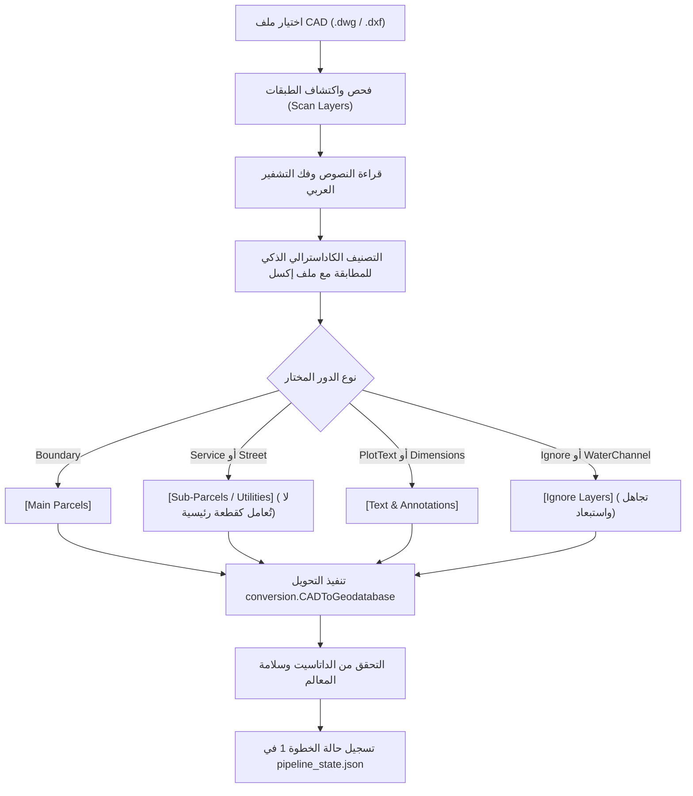

# CAD2GIS — الخطوة 1: استيراد وفحص مخطط الكاد وتعيين الإحداثيات وتصنيف الطبقات
# Step 1: CAD Read, Spatial Reference & Layer Inspection Specification Prompt

---

## 1. الهدف والغرض الهندسي (Goal & Purpose)

تُمثل الخطوة الأولى حجر الأساس في خط الإنتاج الكاداسترالي للتحويل من CAD إلى GIS. تهدف هذه الخطوة إلى:
1. **قراءة ملفات المخطط المساحي (DWG / DXF)** بدقة متناهية دون الاعتماد الإجباري على تثبيت برامج خارجية أو إصدارات أوتوكاد معينة.
2. **استكشاف الطبقات وفحص محتواها الهندسي**: قراءة أعداد العناصر، أنواع الهندسة (خطوط، مضلعات، نقاط، نصوص، أقواس، ونصوص أبعاد)، واستخراج النصوص الخام ونصوص الترميز العربي (Arabic DOS / UTF-8 Decoding).
3. **التصنيف الكاداسترالي الذكي للطبقات (Cadastral Mapping Rules)** وفق المعايير المعتمدة لوزارة الشؤون البلدية والقروية والإسكان (MOMRAH / بلدي):
   - فصل القطع الرئيسية (Main Parcels) عن القطع الفرعية والمرافق والممرات (Sub-Parcels & Utilities).
   - فصل طبقات أرقام ونصوص القطع (Plot Text).
   - حصر طبقات التجاهل (Ignore Layers).
   - **قاعدة الممرات والشوارع:** تصنيف الممرات والشوارع الفرعية (`Street`) ضمن تبويب `Sub-Parcels`؛ بحيث لا تُعامل كقطع رئيسية ولا تُفكك واجهاتها في الخطوة 4، بل تعمل كمجاورات وخدمات.
4. **تعيين الإسقاط الجغرافي والمتري الصحيح**: دعم إسقاطات ميركاتور المستعرض العالمي (UTM WGS84 - النطاقات من 36N إلى 40N) ونظام عين العبد (Ain el Abd 1970) لضمان حساب المساحات والأطوال بالمتر الحقيقي دون تشوه.
5. **التحويل إلى داتاسيت عمل متوافقة (CAD to Feature Dataset)** داخل File Geodatabase موحدة.

---

## 2. تصميم الواجهة وعناصر التحكم (UI/UX Design & Controls)

تعتمد الواجهة على التصميم الاحترافي الداكن (Modern Slate Dark Theme #0B0F19 / #1E293B / #38BDF8):

### أ. بطاقة اختيار ملف الكاد والإسقاط (CAD File & CRS Selection Card)
- **مسار ملف الكاد (CAD File Path):**
  - مربع إدخال مسار (`TextBox`) مع تلميح باهت (`Watermark: اختر ملف DWG أو DXF...`).
  - زر استعراض رسمي (`📂 Browse...`) يفتح `OpenFileDialog` بفلتر `AutoCAD Files (*.dwg;*.dxf)|*.dwg;*.dxf`.
- **نظام الإحداثيات (Spatial Reference / UTM Zone):**
  - قائمة منسدلة (`ComboBox`) مدعومة بقيم مسبقة ومعتمدة:
    - `WGS 1984 UTM Zone 37N (EPSG:32637) - الرياض، مكة، القصيم، حائل (افتراضي)`
    - `WGS 1984 UTM Zone 38N (EPSG:32638) - الشرقية، الجبيل، الخبر`
    - `WGS 1984 UTM Zone 39N (EPSG:32639) - أقصى الشرقية، سلوى`
    - `WGS 1984 UTM Zone 36N (EPSG:32636) - جدة، ينبع، تبوك، المدينة المنورة`
    - `WGS 1984 UTM Zone 35N (EPSG:32635) - أقصى الغربية`
    - `Ain el Abd 1970 / Aramco (EPSG:20499)`
  - شارة تحقق وتوافق مع أنظمة البلدية السعودية.

### ب. مسار Geodatabase التشغيلية (GDB Workspace Card)
- مسار قاعدة البيانات المختارة مع خيارات فورية سريعة عبر أزرار مدمجة:
  - `...`: تصفح لاختيار GDB موجودة.
  - `📦 مجلد Export_Output`: تعيين GDB موحدة تلقائياً داخل مجلد المشروع المعتمد (`Export_Output\Cad2Gis_Workspace.gdb`).
  - `🎯 قاعدة المشروع`: تعيين الـ Default GDB الخاصة بجلسة ArcGIS Pro النشطة.

### ج. زر الاستكشاف والفحص السريع (Scan & Load CAD Layers Button)
- زر بارز عالي التباين `🔍 فحص واستيراد طبقات الكاد (Scan & Load CAD Layers)`:
  - يستدعي أمر `ScanCadLayersCommand`.
  - مؤشر تحميل مدمج (Spinner / Progress Bar) يوضح نسبة استكشاف الكائنات.

### د. جدول قواعد تعيين الطبقات الكاداسترالية (Show Cadastral Mapping Rules Table)
- مقسم إلى **4 تبويبات (Tabs Strip)** مع شارات عددية ديناميكية:
  1. **تبويب `[Main Parcels]`**:
     - يعرض طبقات حدود القطع السكنية والتجارية والاستثمارية الرئيسية.
     - الشارة: `(المحدد / الإجمالي)`.
  2. **تبويب `[Sub-Parcels / Utilities]`**:
     - يعرض قطع الخدمات، المرافق العامة، المساجد، الحدائق، غرف الكهرباء، والمواقف.
     - **يشمل أيضاً الممرات والشوارع الفرعية (`Street`)**: أي طبقة ممر أو شارع لا تُعامل كأرض رئيسية، وتُنقل مباشرة إلى هذا التبويب.
  3. **تبويب `[Text & Annotations]`**:
     - يعرض طبقات أرقام القطع (`PlotText`)، الاستعمالات، والأبعاد.
     - يغذي قائمة اختيار طبقة رقم القطعة الافتراضية للخطوة 2.
  4. **تبويب `[Ignore Layers] (Ignored)`**:
     - **مخصص للتجاهل فقط (`Ignore`)**: طبقات الأبعاد، خطوط التنظيم، الملاحظات، الحدود الوهمية، والطبقات المهملة.
     - يتم استبعاد عناصر هذا التبويب تلقائياً من بناء البارسلات (`IsSelected = false`).

### هـ. شريط الإجراءات السريعة في الجدول (Quick Action Toolbar)
- شارة العدد المباشر: `☑ الطبقات المحددة: X من Y (إجمالي N عنصر)`.
- زر `🎯 تحديد هذه الطبقة فقط`: يركز التحويل على طبقة واحدة فقط.
- زر `✔ تحديد الكل`: تفعيل كافة طبقات القسم النشط.
- زر `❌ إلغاء الكل`: استبعاد كافة طبقات القسم النشط.
- قائمة منبثقة بالنقر الأيمن (`ContextMenu`):
  - `🎯 اختيار هذه الطبقة فقط والانتقال لإنشاء البارسلات ➔`
  - `Move to [Main Parcels]`
  - `Move to [Sub-Parcels / Utilities]`
  - `Move to [Text & Annotations]`
  - `Move to [Ignore Layers]`

### و. أعمدة جدول الطبقات (DataGrid Columns)
1. `Checkbox`: تفعيل/استبعاد الطبقة من المعالجة.
2. `Layer Name`: اسم الطبقة بالكاد مع أيقونة ونمط النص.
3. `Count`: عدد الكائنات الهندسية في الطبقة (مُنسق بالألوف `1,250`).
4. `Geom Type`: نوع الهندسة (Polygon / Line / Text / Point) بلون مميز.
5. `Assigned Role`: قائمة منسدلة لتحديد دور الطبقة (Boundary, Service, Street, PlotText, UsageText, Dimensions, Ignore).
   - **قاعدة فورية:** عند تغيير الدور إلى `Street`، تُنقل الطبقة فوراً إلى تبويب `[Sub-Parcels / Utilities]`.
6. `Raw CAD Text`: عينة من النص الأصلي داخل الكاد.
7. `Decoded Arabic Text`: النص العربي المعالج بعد فك تشفير ترميز الأوتوكاد العربي القديم.

### ز. زر تنفيذ الخطوة 1 (Action Execution Button)
- `🚀 تحويل الكاد إلى داتاسيت (Convert CAD to Geodatabase Dataset)`:
  - يستدعي `ExecuteStep1Command`.
  - يُنشئ Feature Dataset مسقطة بالكامل متضمنة طبقات الخطوط والمضلعات والنصوص.

---

## 3. الوظائف والمنطق البرمجي (Functions & Business Logic)

### الخدمات المسؤولة (Core Services Involved):
1. **`Export_Output Directory Guarantee`**:
   - التحقق التلقائي عند بدء الخطوة الأولى من وجود مجلد `Export_Output`؛ فإن لم يكن موجوداً يتم إنشاؤه فوراً لتجنب أي فشل في أدوات التحويل أو إنشاء الـ GDB.
2. **`CadExtractionService`**:
   - `ExtractLayersFromDxf`: قراءة مباشرة لبنية DXF واستخراج الـ TABLES و ENTITIES.
   - `ExtractLayersFromDwg`: استدعاء سكريبت بايثون الداخلي `extract_cad_layers.py` أو استخدام الفاحص الثنائي الذاتي `ExtractLayersFromDwgBinaryFallback`.
   - `EnrichCadLayerMetadata`: تعيين الألوان والأنماط المعيارية.
   - `InferRoleFromName`: المطابقة النمطية لأسماء الطبقات باللغتين العربية والإنجليزية.
3. **`CadLayerInfo.DetermineCategory(role, layerName)`**:
   - تحديد التبويب الحاكم. تعيين `Street` و `Service` إلى `Sub-Parcels / Utilities`.
   - تعيين `Ignore` إلى `Ignore Layers`.
4. **`ArabicCadDecoder`**:
   - فك عكس النصوص العربية المقلوبة في الأوتوكاد وإصلاح الحروف المشبكة وتوافق محارف DOS/Windows 1256.
5. **تحديد طبقة أرقام القطع (`PlotText`)**:
   - اختيار الطبقة المحددة لنصوص أرقام القطع مع تظليلها ومزامنتها لاستخدامها في الربط المكاني (`Spatial Join`) في الخطوة 2.
6. **تحديد طبقات نصوص الاستخدام (`UsageText`)**:
   - إمكانية تحديد طبقة أو أكثر كـ `UsageText` لتوريث نصوصها مكانياً إلى حقل `REMARKS` في الخطوة 2.
7. **قائمة استعمال الطبقة (`USAGE`)**:
   - قائمة منسدلة اختيارية لكل طبقة لقراءة أكواد الاستخدام المعتمدة (`RSD`, `COM`, `RSC`, `AGR`, `IND`, `UTL`) وحفظها في البروفايل لتوريثها للقطع في الخطوة 2.
8. **`GdbFeatureClassService.ConvertCadToDatasetAsync`**:
   - استدعاء أداة التحويل `conversion.CADToGeodatabase` بنظام الإسقاط المطلوب ومقياس 1000.
9. **`PipelineStateManager.TrySaveStepOutput`**:
   - حفظ مسار الداتاسيت الناتجة، عدد المعالم، ونظام الإحداثيات في `pipeline_state.json`.

---

## 4. القيود ومعايير بلدي (MOMRAH / Balady Standards)

1. **التحقق من مجلد المخرجات:**
   - مجلد `Export_Output` هو المسار المعياري لحفظ Geodatabase العمل (`Cad2Gis_Workspace.gdb`)، ويتم إنشاؤه آلياً إذا لم يكن متوفراً.
2. **التعامل مع الشوارع والممرات:**
   - شوارع المخطط والممرات الفاصلة بين البلوكات والمشاة **ليست قطع أراضي خاصة**، بل فراغات عامة أو مجاورات.
   - تصنيف طبقة الشارع/الممر كـ `Street` يُبقيها ككيان ثانوي ضمن `Sub-Parcels`، مما يتيح للخطوة 2 تحويلها إلى مضلعات خدمية إن رغب المستخدم، ويمنع الخطوة 4 من توليد أضلاع وحدود واتجاهات 4 لها كقطعة، بل يعتبرها مستهدفاً لأشعة استشعار عروض الشوارع.
3. **منع الأبعاد الثلاثية Z/M:**
   - يجب أن تكون المعالم المستخرجة 2D Planar تماماً؛ لإلغاء أي تشوهات ناتجة عن رفع مساحي ثلاثي الأبعاد أو نقاط مناسيب متباينة في الكاد.
4. **التسمية والتوثيق:**
   - الحفاظ على أسماء الطبقات الأصلية في حقل `CadLayer` داخل الداتاسيت لضمان التتبع والمطابقة اللاحقة مع تقرير التدقيق.

---

## 5. شروط التحقق وضمان الجودة (Validation & Quality Gates)

- [ ] التأكد من وجود مجلد `Export_Output` وإنشاؤه إن لم يكن موجوداً.
- [ ] التأكد من وجود ملف الكاد على القرص وقابلية قراءته.
- [ ] التأكد من اختيار نظام إحداثيات متري صالح (EPSG صالح ومطابق للمنطقة الإدارية بالمملكة).
- [ ] التحقق من أن عدد الطبقات المستكشفة أكبر من 0.
- [ ] تصنيف طبقات الممرات والشوارع بدقة ضمن `Sub-Parcels` وتجريدها من صفة القطع الرئيسية.
- [ ] التحقق من نجاح أداة التحويل وظهور `CAD Dataset` مكتملة المعالم في الجيوداتابيس قبل الانتقال إلى الخطوة 2.
