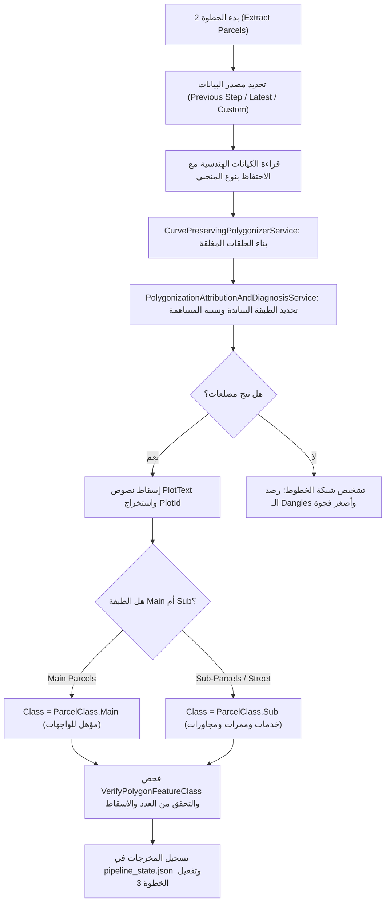

# CAD2GIS — الخطوة 2: بناء واستخراج المضلعات والبارسلات ومعالجة المنحنيات
# Step 2: Polygonization, True Curves Preservation & Parcel Extraction Prompt

---

## 1. الهدف والغرض الهندسي (Goal & Purpose)

تُمثل الخطوة الثانية قلب التحويل الهندسي؛ حيث يتم تحويل الخطوط المفتوحة والمغلقة ومضلعات الكاد إلى **مضلعات مساحية طوبولوجية نظيفة (Cadastral Parcels)** متوافقة مع قواعد بلدية المملكة:
1. **استخراج مضلعات البارسلات (Parcels Extraction):** قراءة المضلعات المعرفة في الكاد أو تحويل شبكات الخطوط (`Line to Polygon`) لإنشاء حدود قطع الأراضي بدقة مستوية ثنائية الأبعاد (2D Planar) خالية من إحداثيات Z أو قياسات M.
2. **الحفاظ الصارم على المنحنيات الحقيقية (True Curves Preservation):**
   - منع تحويل الأقواس الدائرية (`CircularArc`) والمنحنيات البيضاوية (`EllipticArc`) أو منحنيات بيزيير (`CubicBezier`) إلى مضلعات مقطعة من نقاط مستقيمة (No Densification or Tessellation).
   - تخزين الهندسة البارامترية الأصلية في قاعدة بيانات File Geodatabase لحفظ الدقة المليمترية للأقواس والشطفات الدائرية.
3. **التصنيف الصارم بين القطع الرئيسية والفرعية (Main vs Sub Parcels):**
   - القطع الرئيسية (`ParcelClass.Main / PARCEL_TYP = 1`): الأراضي السكنية والتجارية التي تخضع لتفكيك الواجهات والاتجاهات الأربعة والأبعاد وحساب عروض الشوارع.
   - القطع الفرعية (`ParcelClass.Sub / PARCEL_TYP = 2`): تشمل المرافق، الخدمات، الحدائق، المساجد، **والممرات والشوارع الفرعية (`Street`)**. هذه القطع لا تُفكك واجهاتها في الخطوة 4، بل تعمل كمجاورات وتخديم للقطع الرئيسية.
4. **الربط المكاني الذكي لأرقام القطع (Spatial Text Overlay):**
   - استخراج أرقام القطع (`PlotId`) مكانياً من طبقة النصوص المختارة (`PlotText`) الواقعة داخل كل مضلع (Point-in-Polygon).
5. **التشخيص القائم على القياسات عند فشل التقفيل (Data-Driven Diagnosis):**
   - في حال نتج 0 مضلع، لا يُكتفى برسالة خطأ عامة، بل يتم تشغيل خدمة `DiagnoseLineNetwork` لحساب أطراف الخطوط السائبة (Dangles) وقياس أصغر فجوة (Smallest Gap Distance) بالمتر وإرشاد المساح.

---

## 2. تصميم الواجهة وعناصر التحكم (UI/UX Design & Controls)

تنسيق مرئي داكن متكامل (Tab 2: Extract Parcels):

### أ. بطاقة مصدر بيانات التشغيل (Working Data Source Card - Part B)
- **أزرار اختيار المصدر (Per-Step Data Source Mode):**
  - `🔘 جلسة العمل من الكاد/الداتاسيت (CAD Session / Dataset) (افتراضي)`: يقرأ مباشرة من ناتج الخطوة 1 المحفوظ في الذاكرة أو GDB.
  - `🔘 أحدث تصدير يشمل تعديلاتي (Latest export)`: يقرأ من أحدث نسخة مُصدرة على القرص عند رغبة المستخدم في استئناف العمل على تعديل سابق.
  - `🔘 استخدام بياناتي الخاصة (Use My Own Data)`: يتيح اختيار طبقة من خريطة Pro الحالية أو Feature Class خارجية.
- **شريط ملخص مصدر التشغيل (Working From Summary Bar):**
  - يعرض المسار الفعلي، عدد المعالم، ونظام الإسقاط.
  - زر `📁 فتح المجلد`: استعراض مجلد البيانات في Windows Explorer.
  - زر `🔄 تغيير / استعراض`: استعراض سجل التصديرات السابقة (`Export History Dropdown`).
- **شريط تنبيه التصدير المعدل يدوياً (Edited After Export Banner):**
  - يظهر بلون كهرماني تحذيري إذا تم تعديل البيانات خارجياً بعد التصدير.

### ب. إعدادات نمط ونطاق الطبقات (Layer Geometry Mode & Scope)
1. **نوع هندسة الطبقات المستخدمة (Layer Geometry Mode):**
   - `Both (مضلعات وخطوط معاً) (افتراضي)`: يقرأ مضلعات الكاد ويقوم أيضاً بتحويل الخطوط المؤهلة ودمجهما معاً.
   - `Polygon Only`: قراءة المضلعات المغلقة الأصلية فقط بالكاد.
   - `Line Only`: تحويل شبكة الخطوط حصرياً إلى مضلعات.
2. **نطاق طبقات بناء المضلعات (Polygon Layer Scope):**
   - `Main & Sub (قطع رئيسية وخدمات)` (افتراضي).
   - `Main Only (القطع الرئيسية فقط)`: يتجاهل طبقات الخدمات والممرات والشوارع.
   - `All Except Text (كافة الطبقات ما عدا النصوص)`.
3. **طبقة نصوص أرقام القطع (Plot Text Layer Selector):**
   - قائمة منسدلة ذكية تعرض تلقائياً طبقة النصوص المحددة كـ `PlotText` مع خيار التحديد اليدوي لأي طبقة نصوص أخرى.

### ج. إعدادات المنحنيات والتسامح الهندسي المتقدمة (Advanced Tolerances)
- خيار الحفاظ التام على المنحنيات الحقيقية (`Keep True Curves Intact`).
- تسامح تجميع النقاط (Cluster Tolerance): الافتراضي `0.001 م` (1 ملم) لمنع إزاحة النقاط وتشويه الحدود.
- تسامح إغلاق الفجوات الدقيقة (Minimal Gap Bridge Tolerance): حتى `0.05 م` للخطوط المتقاربة دون تغيير إحداثيات الرؤوس الأصلية.

### د. أزرار التشغيل والتصدير (Action Controls)
- زر التنفيذ الرئيسي: `🔨 Run Step 2 (Extract & Polygonize Parcels)`:
  - تشغيل غير متزامن (`Async Background Task`) مع شريط تقدم ونسبة مئوية ورسائل تفصيلية.
- زر التصدير المرحلي: `💾 Export Step 2 Parcels`:
  - تصدير بارسلات الخطوة 2 إلى Feature Class منفصلة والتحقق منها قبل الانتقال.

---

## 3. الوظائف والمنطق البرمجي (Functions & Business Logic)

### الخدمات المسؤولة (Core Services Involved):
1. **`CurvePreservingPolygonizerService` & `DominantLayerMatcher`**:
   - بناء مضلعات دقيقة من خطوط وأقواس متباينة دون تكسير الأقواس.
   - في نمط "Line with data layer": تشغيل `SplitLine` ثم حساب طول كل طبقة حول حدود كل مضلع وتوريث كود `USAGE` والتصنيف (`MAIN`/`SUB`) من الطبقة السائدة.
2. **`PlotIdExtractorService.AssignPlotIds` (الربط المكاني لأرقام القطع)**:
   - ربط مكاني (`Spatial Join`) لنصوص طبقة `PlotText` المختارة في الخطوة الأولى الواقعة داخل المضلع.
   - في حال لم يسقط الرقم بدقة داخل المضلع، يتم تشغيل مطابقة الجوار المكاني (`Proximity Matching`) حتى 20 متراً من مركز القطعة.
3. **استخراج استعمال القطعة (`USAGE`)**:
   - في مضلعات الكاد (`Polygon`): أخذ كود الاستخدام مباشرة من تصنيف الطبقة المحددة في الخطوة الأولى (`SelectedUsage` أو الكلمات الدلالية أو `UTL` لقطع الخدمات).
   - في خطوط مع طبقة البيانات (`Line with data layer`): أخذ الاستخدام من الطبقة السائدة للحدود المجمعة.
4. **استخراج الملاحظات (`REMARKS`) بالربط المكاني**:
   - أخذ الملاحظات ونصوص الأنشطة مكانياً (`Spatial Join`) من الطبقة أو الطبقات المتعددة المختارة كـ `UsageText` في الخطوة الأولى الواقعة داخل المضلع.
   - دمج نصوص الاستخدام في حال تعدد النصوص داخل نفس القطعة.
5. **`ParcelPolygonizer`**:
   - تنظيف المضلعات والتأكد من إزالة أي تشوهات طوبولوجية أو قمم مكررة متطابقة (Duplicate Vertices).
   - حساب المقاييس المسطحة المترية المعتمدة (`AreaSqm`, `Perimeter`, `Centroid`).
6. **`GdbFeatureClassService.VerifyPolygonFeatureClass`**:
   - فحص Feature Class الناتجة والتأكد من وجودها ومطابقة عدد البارسلات وسلامة نظام الإحداثيات المسقط.

---

## 4. القواعد الكاداسترالية والحدود الحرجة (Cadastral Rules)

1. **الربط المكاني الصارم لأرقام القطع والملاحظات:**
   - رقم القطعة `PLOT_ID` يُؤخذ مكانياً بالدرجة الأولى من طبقة `PlotText` المحددة في الخطوة الأولى.
   - الملاحظات `REMARKS` تُؤخذ مكانياً من طبقات `UsageText` المحددة في الخطوة الأولى (مع إمكانية تحديد أكثر من طبقة لنصوص الأنشطة والملاحظات).
2. **تحديد كود الاستخدام `USAGE`:**
   - يورث كود الاستخدام المعتمد من تصنيف طبقات الكاد المحددة في الخطوة الأولى، ويبقى محفوظاً كقيمة معتمدة لحين الوصول للخطوة الثالثة.
3. **التعامل مع الشوارع والممرات المستخرجة كمضلعات:**
   - إذا تم استخراج مضلع من طبقة صُنفت كـ `Street` أو واقعة في تبويب `Sub-Parcels`:
     - يتم تعيين `parcel.Class = ParcelClass.Sub`.
     - يُسجل نوع العقار أو الاستعمال كممر / شارع / خدمة (`UTL`).
     - **الحظر الصارم:** لا يتم تمرير هذه القطع إلى محرك تفكيك الواجهات والأضلاع في الخطوة 4؛ لأن الممرات والشوارع لا تملك اتجاهات 4 نظامية خاصة برخص البناء أو وثائق الملكية، بل تعمل كأجسام مجاورة (Neighbors) تستقبل أشعة استشعار عروض الشوارع.
4. **منع الازدواجية والتطابق (De-duplication):**
   - فحص تطابق المساحة والمركز الهندسي (Centroid) بحد تسامح `0.2 م` لمنع تكرار نفس الأرض إذا كانت مرسومة في الكاد كمضلع مغلق وفي نفس الوقت كخطوط محيطة.
5. **تجميد المقاييس (Frozen Planar Metrics):**
   - تسجيل المساحة في حقل `AREA_SQM` والمحيط في `Shape_Leng` وفق الإسقاط المتري للجيوداتابيس مع الحفاظ على القيمة الأصلية حتى لو فُتحت الخريطة بإسقاط كروي مختلف.

---

## 5. شروط التحقق وضمان الجودة (Validation & Quality Gates)

- [ ] التأكد من أن عدد المضلعات المستخرجة يطابق أو يقارب عدد الأراضي المتوقعة في المخطط.
- [ ] التأكد من خلو الطبقات من أي مضلعات مقلوبة (Self-intersecting) أو مشوهة.
- [ ] التحقق من أن جميع الأقواس الدائرية حقيقية وليست مضلعة عبر `NativeCurveAuditHelper.HasCurves`.
- [ ] التأكد من تصنيف جميع الممرات والخدمات كـ `ParcelClass.Sub`.
- [ ] اجتياز فحص `VerifyPolygonFeatureClass` قبل حفظ الحالة واعتماد الخطوة كمنجزة.
