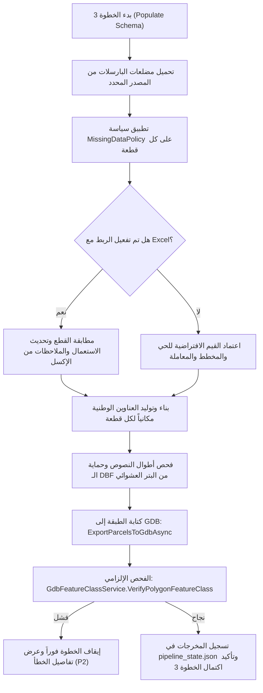

# CAD2GIS — الخطوة 3: تعبئة وتدقيق بيانات المخطط والاسكيما البلدية المعتمدة
# Step 3: Municipal Schema, Attribute Population & Verification Prompt

---

## 1. الهدف والغرض الهندسي (Goal & Purpose)

تهدف الخطوة الثالثة إلى نقل البيانات من مجرد أشكال هندسية مجردة إلى **قاعدة بيانات كاداسترالية بلدية رسمية (MOMRAH Cadastral Geodatabase)** تفي بجميع متطلبات منصة "بلدي" واللائحة الفنية للأراضي والمساحة:
1. **تعبئة اسكيما البارسلات الرسمية (`PARCEL` Feature Class):** بناء الجداول وحقول البيانات المعتمدة وفقاً للنموذج القياسي (Data Dictionary):
   - البيانات المكانية والإدارية: `PLAN_NO`, `PLOT_ID`, `BLOCK_NO`, `LAYOUT`, `NEIGHBOURH`, `REGION_ID`, `CITY_ID`, `ADDRESS`.
   - الاستخدام والنشاط: `USAGE`, `REMARKS`, `PARCEL_TYP`, `REALESTA_1`.
   - المباني والطلبات: `ISBUILDING`, `BUILDINGTY`, `REQUEST_TY`, `REQUEST_NO`, `REPORT_NO`.
   - المقاييس المحفوظة: `AREA_SQM`, `Shape_Area`, `Shape_Leng`.
2. **سياسة معالجة البيانات المفقودة (Missing Data Policy):** ملء الحقول الإلزامية الناقصة تلقائياً من بيانات المخطط العامة (Project Metadata) أو مصفوفة القواعد البلدية دون ترك حقول فارغة تُفشل الرفع على منصة بلدي.
3. **الربط مع جداول المساحات والاستخدامات (Excel Integration & Priority):**
   - **أولوية حقل `USAGE` (الاستعمال):**
     * **الأولوية 1 (القصوى):** ملف الإكسل (`PARCEs_landuse.xlsx` أو الإكسل المخصص للخطوة 3). إذا تطابق رقم القطعة `PLOT_ID` ووُجد كود/اسم استعمال معتمد، فإنه يعتمد ويتفوق على أي مصدر آخر.
     * **الأولوية 2:** التصنيف المعتمد لطبقات الكاد من الخطوة 1/2 (سواء عبر اختيار طبقة مضلع `Polygon` أو عبر مطابقة الطبقة السائدة في نمط `Line with data layer`) مع استخراج الكود الصافي عبر `MunicipalLookups.ExtractUsageCode`.
     * **الأولوية 3:** القيمة الافتراضية النظامية (`RSD` سكني).
   - **أولوية حقل `REMARKS` (الملاحظات والوصف):**
     * **الأولوية 1 (القصوى):** ملف الإكسل إذا احتوى على عمود الملاحظات أو نوع الاستعمال الفرعي.
     * **الأولوية 2:** الربط المكاني (Spatial Join) لنصوص طبقات `UsageText` المختارة في الخطوة 1 (يدعم طبقات متعددة ويجمع نصوصها داخل المضلع بفاصل ` - `).
     * **الأولوية 3:** الوصف التلقائي المعتمد المرتبط بكود الاستعمال عبر `MunicipalLookups.GetRemarksForUsage`.
4. **التدقيق والتحقق الإلزامي قبل تسجيل الحالة (Verification Before State Registration):**
   - **قاعدة حرجة (P2):** التحقق المادي من كتابة الطبقة في Geodatabase وفحص سلامتها عبر `VerifyPolygonFeatureClass` قبل حفظ الحالة كمنجزة في `pipeline_state.json` وقبل السماح بالانتقال للخطوة 4. وفي حال حدوث أي خطأ، يتم إيقاف الإجراء فوراً وإظهار تفاصيل الخطأ دون ادعاء النجاح الصوري.

---

## 2. تصميم الواجهة وعناصر التحكم (UI/UX Design & Controls)

واجهة مريحة وعملية منظمة ضمن بطاقات قابلة للطي (Tab 3: Populate Schema):

### أ. محدد مصدر البيانات قيد المعالجة (Step 3 Source Selector)
- اختيار نمط التشغيل المستقل للخطوة 3:
  - `🔘 جلسة العمل الحالية (Session data) (افتراضي)`: استلام مضلعات الخطوة 2 الموثقة.
  - `🔘 أحدث تصدير يشمل تعديلاتي (Latest export)`: استخدام أحدث Feature Class تم تصديرها للقرص.
  - `🔘 استخدام بياناتي الخاصة (Use My Own Data)`: اختيار طبقة بارسلات خارجية من الخريطة أو ملف GDB/Shapefile.
- شريط تفاصيل المصدر المعتمد مع زر فتح المجلد وزر استعراض السجل.

### ب. لوحة إدخال البيانات البلدية القياسية (Standard Municipal Metadata Panel)
- **بيانات المخطط:**
  - `Plan No (رقم المخطط - PLAN_NO)`: مثل `0000/0` أو `1440/123`.
  - `Neighbourhood Code (كود الحي - NEIGHBOURH)`: مثل `10101001`.
  - `Region ID (رمز المنطقة)` و `City ID (رمز المدينة)`: قوائم أو رموز معتمدة (مثل 01 للرياض، 02 لمكة).
  - `Block No (رقم البلوك)` و `Layout (اسم المخطط/المجاورة)`.
- **بيانات المعاملة والتقرير:**
  - `Request Type (نوع الطلب)`: (فرز، دمج، مخطط معتمد، تجزئة، تصحيح وضع).
  - `Request No (رقم المعاملة)` و `Report No (رقم التقرير المساحي)`.
- **معلومات المباني الافتراضية:**
  - `IsBuilding`: تحديد ما إذا كانت القطعة مبنية (0=أرض فضاء، 1=مبنية).
  - `Building Type`: نوع البناء (سكني، تجاري، خدمات).
- زر ذكي: `📍 بناء العنوان الوطني مكانياً (Detect Address from Main Parcels)`:
  - تجميع الاسم التلقائي للعنوان: `[اسم الحي] - [رقم المخطط] - قطعة رقم [رقم القطعة]`.

### ج. لوحة الربط مع ملف إكسل المساحات (Areas Excel Mapping Panel)
- خيار التفعيل: `ربط وتحديث البيانات من ملف جداول المساحات (Areas Excel)`.
- مسار ملف الإكسل مع زر تصفح `📄 Browse Excel...`.
- قوائم مطابقة الأعمدة الذكية:
  - حقل رقم القطعة في الإكسل (Plot ID Column).
  - حقل الاستعمال أو النشاط (Usage Column).
  - حقل المساحة المحسوبة (Area Column).
  - حقل الملاحظات والوصف (Remarks / SubType Column).

### د. جدول المعاينة المباشرة للبارسلات (Parcels Attribute DataGrid)
- جدول حي يعرض القطع بعد ملء البيانات مع ألوان تمييزية:
  - القطع الرئيسية تظهر بحدود صفراء/ذهبية.
  - القطع الفرعية والممرات تظهر بحدود سماوية وخضراء.
- أعمدة الجدول: `Plot ID`, `Class`, `Usage`, `Area (m²)`, `Plan No`, `Address`, `Remarks`.

### هـ. أزرار التنفيذ والتصدير (Action Controls)
- زر التنفيذ الرئيسي: `🚀 Populate Schema & Validate Fields (الخطوة 3)`:
  - تشغيل تعبئة البيانات والتحقق الميداني.
- زر التصدير والتحقق: `💾 Export Step 3 Populated Parcels`:
  - تصدير طبقة `PARCEL` إلى Geodatabase وفحصها هندسياً وجدولياً عبر `VerifyPolygonFeatureClass`.

---

## 3. الوظائف والمنطق البرمجي (Functions & Business Logic)

### الخدمات المسؤولة (Core Services Involved):
1. **`MissingDataPolicy`**:
   - ملء الحقول الإلزامية الفارغة: `PlanNo`, `Neighbourhood`, `RegionId`, `CityId`, `Address`, `RequestType`, `RequestNo`, `ReportNo`.
   - تعيين الملاحظات النظامية (`MunicipalLookups.GetRemarksForUsage`) تلقائياً بناءً على كود الاستعمال.
2. **`DbfTextLengthService`**:
   - فحص أطوال النصوص بمقياس بايتات UTF-8 لمنع تجاوز الحدود القصوى لجداول Shapefile/DBF (مثل حقل `ADDRESS` أقصى حد 254 بايت، `NEIGHBOURH` 50 بايت) ومعالجة البتر الآمن عند حدود الكلمات العربية دون إفساد الحروف.
3. **`GdbFeatureClassService.VerifyPolygonFeatureClass` (معيار P2)**:
   - يفتح Geodatabase، يفحص وجود الطبقة، يتأكد من أن نوع الهندسة مضلع (`Polygon`)، يتحقق من أن عدد المعالم يطابق تماماً عدد البارسلات المتوقعة، ويفحص تطابق نظام الإحداثيات (`WKID`).
4. **`PipelineStateManager.TrySaveStepOutput`**:
   - تسجيل المسار المعتمد لطبقة `PARCEL` وتاريخها الزمني وعدد معالمها في `pipeline_state.json` لتستند إليها الخطوة 4 بثقة مطلقة.

---

## 4. القواعد الكاداسترالية والحدود الحرجة (Cadastral Rules)

1. **حماية حقل `PARCEL_TYP` وتصنيف الممرات:**
   - القطع الرئيسية: `PARCEL_TYP = 1` و `Class = ParcelClass.Main`.
   - القطع الفرعية والممرات والشوارع: `PARCEL_TYP = 2` و `Class = ParcelClass.Sub`.
   - حقل `PARCEL_CLASS` هو حقل عمل داخلي مؤقت، ويتم إسقاطه تلقائياً في التصدير النهائي للالتزام التام بالاسكيما البلدية المعتمدة.
2. **تجميد المساحات المترية (Frozen Metrics Preservation):**
   - القيمة المكتوبة في حقل `AREA_SQM` تُحسب بمقياس UTM المستوي المباشر وتُجمد كرقم عشري، مما يمنع اختلاف المساحة في حال أعاد نظام بلدي أو برنامج الـ GIS عرض البيانات بإسقاط جغرافي (GCS WGS84).
3. **عدم السماح بالسقوط الصامت (No Silent Failure):**
   - إذا فشلت كتابة الجيوداتابيس أو كانت الطبقة فارغة، لا يُسمح بإظهار "تم الاكتمال بنجاح"، ويتم إيقاف خط الإنتاج فوراً مع إبراز السبب المساحي.

---

## 5. شروط التحقق وضمان الجودة (Validation & Quality Gates)

- [ ] التأكد من خلو حقول `PLOT_ID`, `PLAN_NO`, `USAGE` من أي قيم فارغة أو بيضاء لجميع القطع الرئيسية.
- [ ] التأكد من مطابقة عدد القطع المعبأة مع إجمالي مضلعات الخطوة 2.
- [ ] التأكد من أن أطوال النصوص العربية متوافقة مع محددات الحقول ولا تتجاوز الحدود المسموحة.
- [ ] اجتياز دالة `VerifyPolygonFeatureClass` بنجاح 100%.
- [ ] تسجيل المعطيات الموثقة بنجاح في `pipeline_state.json`.
