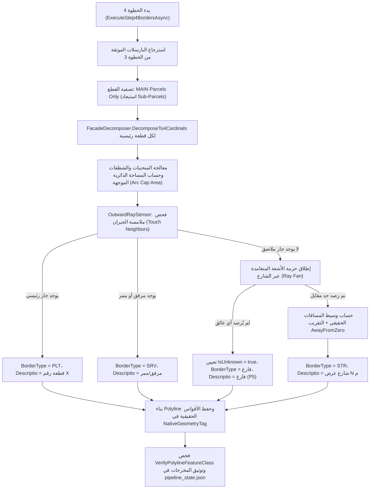

# CAD2GIS — الخطوة 4: تفكيك واجهات القطع واستشعار الشوارع والمجاورات وحساب العروض
# Step 4: 4-Cardinal Boundary Model, Facade Decomposition & Street Sensing Prompt

---

## 1. الهدف والغرض الهندسي (Goal & Purpose)

تُمثل الخطوة الرابعة إحدى أكثر الخطوات تميزاً وتفرداً هندسياً في نظام CAD2GIS؛ حيث تُطبق **نموذج الاتجاهات الأربعة المعتمد لوزارة الشؤون البلدية والقروية والإسكان (MOMRAH 4-Cardinal Boundary Model)** المخصص لطبقة الحدود (`border.shp` / `Border` Feature Class):
1. **تفكيك حدود القطع الرئيسية حصرياً (MAIN Parcels Only):**
   - **قاعدة ذهبية:** يتم تفكيك واجهات وحدود القطع الرئيسية فقط (`PARCEL_TYP = 1` و `Class = ParcelClass.Main`).
   - **القطع الفرعية والممرات:** قطع الخدمات والمرافق والشوارع والممرات (`Sub-Parcels / Street`) **لا يتم استخراج واجهات أو حدود 4 لها إطلاقاً**؛ لأنها ليست أراضي ملكية خاصة خاضعة للتراخيص، وإنما تعمل ككيانات مجاورة ومستقبلة لأشعة الاستشعار.
2. **الالتزام الصارم بالاتجاهات الأربعة الأصلية:**
   - استخراج ما لا يزيد عن 4 خطوط أحادية الجزء (Single-part Polylines) لكل حلقة:
     - `1 = North (شمال)`
     - `2 = East (شرق)`
     - `3 = South (جنوب)`
     - `4 = West (غرب)`
   - **منع اختلاق أو اصطناع خطوط (No Invented Lines):** إذا كانت القطعة مثلثة الشكل (3 أضلاع فقط) أو سداسية بدون ضلع باتجاه معين، لا يتم اختلاق خط مفقود، بل يتم وسم القطعة في الملاحظات بـ `FEWER_THAN_4_DIRECTIONS`.
3. **الحفاظ على المنحنيات والشطفات الحقيقية (True Curves Intact):**
   - تعمل الخوارزمية مباشرة على عناصر الحدود الأصلية؛ فالأقواس الدائرية تظل أقواساً بارامترية حقيقية ضمن خط الواجهة دون تكسيرها إلى نقاط.
   - معالجة الشطفات (Chamfers) المائلة بحد أقصى `7 أمتار` وزاوية `45° ± 15°` وضمها هندسياً بسلاسة إلى الواجهة الأنسب دون تشويه أطوال الأضلاع.
4. **استشعار الشوارع والمجاورات بالأشعة المتعامدة (Outward Ray Sensing):**
   - فحص المجاورات الملاصقة أولاً (Touch Neighbors): إذا كانت ملاصقة لقطعة رئيسية أخرى تسجل كـ `PLT` (قطعة رقم X). وإذا كانت ملاصقة لمرفق أو ممر تسجل كـ `SRV` (مرفق / ممر مشاة).
   - إطلاق حزمة أشعة متعامدة (Ray Fan: 0°, ±15°, ±30°) نحو الفراغ من منتصف أطول ضلع خارجي مع إزاحة أمان `0.05 م` عن الحد.
   - حساب وسيط القياسات الحقيقي (True Median) وتطبيق التقريب المتماثل الصارم `Math.Round(..., MidpointRounding.AwayFromZero)`.
   - **التعامل مع الحالات غير المستشعرة (P5):** في حال عدم وجود جار أو شارع مقابل، يتم تعيين `IsUnknown = true` وترك `BorderType = ""` و `Descriptio = ""` فارغين في المخرجات الرسمية (ولا يظهر نص "UNKNOWN" إلا في جداول تقارير الفحص الداخلي).

---

## 2. تصميم الواجهة وعناصر التحكم (UI/UX Design & Controls)

تصميم احترافي داكن (Tab 4: Extract Borders & Infer Widths):

### أ. بطاقة مصدر بيانات المعالجة (Working Data Source Card - Step 4)
- محدد مصدر بيانات البارسلات:
  - `🔘 أحدث تصدير يشمل تعديلاتي (Latest export)`: استخدام البارسلات المعتمدة المصدرة.
  - `🔘 جلسة العمل الحالية (Session data) (افتراضي)`: استلام مخرجات الخطوة 3 الموثقة من `pipeline_state.json`.
  - `🔘 بياناتي الخاصة (User own data)`: اختيار طبقة من الخريطة.
- شارة `ShowEditedAfterExportBanner` للتنبيه في حال تم تعديل البارسلات بالخريطة بعد الخطوة 3.
- شارة التوجيه والتنبيه الصادرة عن البروفايل `ShowLatestExportBanner`.

### ب. إعدادات تفكيك الواجهات والشطفات (Chamfer & Facade Options)
- خيار دمج الشطفات `Merge Chamfers` (مفعل افتراضياً).
- حد طول الشطفة الأقصى `Chamfer Threshold`: الافتراضي `7.0 م`.
- زاوية الشطفة وتسامحها: زاوية `45.0°` بتسامح `±15.0°`.
- نطاق زوايا الأركان المنعكسة (`Reflex Corners`): `200° إلى 350°`.
- زاوية انحراف القطع متعددة الأجزاء: `30°`.

### ج. إعدادات استشعار الشوارع وعروضها (Street Sensing Options)
- زوايا حزمة الأشعة المتعامدة (Ray Angles): `[-30, -15, 0, 15, 30]`.
- أقصى مسافة استشعار للأشعة: الافتراضي `60.0 م`.
- مسافة ملامسة الجار (Touch Buffer): `0.20 م`.
- إزاحة بداية الشعاع (Ray Start Offset): `0.05 م` لتفادي التقاطع الذاتي مع خط الواجهة نفسه.

### د. جدول مراجعة واعتماد عروض الشوارع المستشعرة (Inferred Widths Review Table)
- جدول تفاعلي ذكي يعرض كافة الحدود التي تم استشعار عروض شوارع لها:
  - `Plot ID`: رقم القطعة المستفيدة.
  - `Direction`: الاتجاه بالعربية (شمال، شرق، جنوب، غرب) بلون دال.
  - `Measured Width`: العرض المقاس الفعلي بالأشعة بالمتر (مثل `15.02 م`).
  - `Suggested Width`: العرض النظامي المقترح والمقرب (مثل `15.00 م`).
  - `Descriptio`: نص الوصف البلدية المولد (مثل `شارع عرض 15 م`).
  - `Border Type`: نوع الحد (`STR` للشارع، `PLT` للأرض، `SRV` للمرفق/الممر).
  - `IsAccepted (Checkbox)`: مربع اختيار للموافقة على العرض المقترح أو تعديله يدوياً.
- أزرار التحكم السريع:
  - `✔ قبول كافة العروض المقترحة (Accept All Inferred)`
  - `🔄 تطبيق العرض المقترح على المحدد (Apply Suggested Width)`

### هـ. أزرار التشغيل والتصدير (Action Controls)
- زر التنفيذ الرئيسي: `🚀 Run Step 4 (Decompose Borders & Sense Streets)`:
  - تنفيذ التفكيك والاستشعار في الخلفية مع شريط تقدم يبين النسبة ورقم القطعة الجاري معالجتها.
- زر التصدير والتحقق: `💾 Export Step 4 Borders`:
  - تصدير طبقة `border` إلى Geodatabase وفحص سلامتها عبر `VerifyPolylineFeatureClass`.

---

## 3. الوظائف والمنطق البرمجي (Functions & Business Logic)

### الخدمات المسؤولة (Core Services Involved):
1. **`BorderExtractionCore` (معالجة الحالات الحرجة P4):**
   - حساب المساحة الموجهة لحلقات الأقواس الدائرية مع إضافة مساحة القبة الدائرية (`Arc Cap Area`) الموقعة باتجاه القوس `(isCcwArc ? 2.0 : -2.0) * capArea`؛ لضمان عدم انقلاب متجهات الخروج في الدوائر المكونة من قوسين أو نهايات الممرات المقفلة.
   - حلقة تتبع الحدود المحدثة `do...while (walked < segCount && (currSeg != endVtx || splitIndices.Count == 1));` تضمن عدم توقف التفكيك في الحلقات التي تحتوي على نقطة تقسيم وحيدة أو أقل من 4 أضلاع.
2. **`FacadeDecomposer`:**
   - الحفاظ التام على الأقواس المنحنية الحقيقية عبر `NativeGeometryTag` (`ArcGIS.Core.Geometry.Segment`).
   - معالجة الجزر والفجوات الداخلية (Holes) كأجزاء مستقلة بأرقام حلقات `RingIndex > 0`.
3. **`WidthInferenceService` و `OutwardRaySensor` (التناغم والتطابق P5):**
   - استخدام نفس إزاحة الأمان الموحدة `0.05 م`.
   - حساب الوسيط للأعداد الزوجية كمتوسط حسابي دقيق للعنصرين الأوسطين `(mid1 + mid2) / 2.0`.
   - استخدام أسلوب التقريب الموحد `Math.Round(..., MidpointRounding.AwayFromZero)`.
   - ضبط علامة `IsUnknown = true` مع ترك النصوص فارغة في جداول التسليمات الرسمية.
4. **`GdbFeatureClassService.VerifyPolylineFeatureClass`:**
   - التحقق من وجود طبقة الخطوط `border` ومطابقة عدد الخطوط وسلامة الإسقاط.

---

## 4. القواعد الكاداسترالية والحدود الحرجة (Cadastral Rules)

1. **حظر تفكيك الممرات والخدمات:**
   - مضلعات الممرات والشوارع المصنفة كـ `Sub-Parcels` لا تُفكك حدودها إطلاقاً؛ فمخرجات الخطوة 4 مخصصة للقطع السكنية والتجارية والاستثمارية التي تستوجب رخص بناء وحدود ملكية.
2. **عدم اختلاق حدود وهمية (No Phantom Borders):**
   - إذا كانت الأرض مطلة على 3 شوارع فقط ولا تملك حداً رابعاً، يُترك الحد الرابع غير موجود، ويُسجل في حقل `Remarks` الخاص بالقطعة عبارة `FEWER_THAN_4_DIRECTIONS`.
3. **التحقق من عدم ضياع أي جزء من المحيط (Perimeter Conservation):**
   - فحص الحفظ الهندسي: مجموع أطوال خطوط الواجهات الناتجة للقطعة يجب أن يطابق بدقة متناهية محيط المضلع الأصلي بفارق لا يتجاوز `0.0001 م`.

---

## 5. شروط التحقق وضمان الجودة (Validation & Quality Gates)

- [ ] التأكد من أن جميع خطوط الحدود المستخرجة تتبع قطعاً رئيسية فقط (`ParcelClass.Main`).
- [ ] التأكد من سلامة اتجاهات النورمال الخارجية (Outward Normals) وتعامدها نحو الخارج.
- [ ] التأكد من أن جميع الحالات غير المستشعرة تحمل `IsUnknown = true` مع خلو حقول `BorderType` و `Descriptio` من أي نصوص عشوائية في التسليم الرسمي.
- [ ] التأكد من أن عروض الشوارع المعتمدة مطابقة للائحة البلدية (مثل 10، 12، 15، 20، 30، 40، 60 متراً).
- [ ] اجتياز فحص `VerifyPolylineFeatureClass` وتسجيل حالة الخطوة 4 في `pipeline_state.json`.
