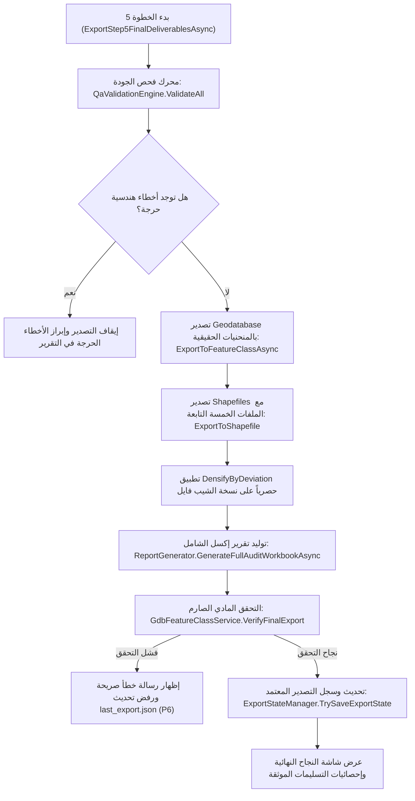

# CAD2GIS — الخطوة 5: الفحص النهائي ومطابقة الجودة وتصدير المخرجات الرسمية
# Step 5: QA/QC Validation Engine, Multi-Format Deliverables & Export Prompt

---

## 1. الهدف والغرض الهندسي (Goal & Purpose)

تُمثل الخطوة الخامسة بوابة الجودة والاعتماد النهائي لكامل خط الإنتاج الكاداسترالي؛ حيث تضمن تسليم مخرجات مطابقة 100% لاشتراطات أمانات المدن ووزارة البلديات والإسكان (MOMRAH / بلدي):
1. **محرك التحقق وضمان الجودة الشامل (Comprehensive QA/QC Engine):**
   - فحص الاسكيما واكتمال الحقول الإلزامية (`PlotId`, `PlanNo`, `Usage`, `BorderName`, `BorderType`, إلخ).
   - التحقق الطوبولوجي وتطابق المقاييس: التحقق من عدم وجود تداخلات غير نظامية، ومطابقة مساحات المضلعات مع مجموع أطوال الحدود.
   - فحص سلامة المنحنيات الحقيقية والتأكد من عدم تكسيرها في النسخة الجيوداتابيس.
   - فحص حدود أطوال البايتات لحقول جداول الـ DBF لمنع فقدان البيانات أو تشوه المحارف العربية.
2. **توليد حزم المخرجات الرسمية متعددة التنسيقات (Multi-Format Deliverables):**
   - **قاعدة بيانات File Geodatabase (`Final.gdb` / `Export_Deliverables.gdb`):**
     - تحتوي على طبقات `PARCEL` و `border` بكامل المنحنيات البارامترية الحقيقية (True Curves) مع الاحتفاظ بنظام الإسقاط المتري الدقيق (UTM).
   - **حزم ملفات الـ Shapefile الرسمية للمنصات الحكومية:**
     - تصدير حزمة `PARCEL.shp` وحزمة `border.shp` متضمنة **الملفات الخمسة التابعة كاملة لكل طبقة** (`.shp`, `.shx`, `.dbf`, `.prj`, `.cpg` بترميز UTF-8).
     - **قاعدة المنحنيات في الشيب فايل:** تطبيق التكثيف الانحرافي المحكوم (`GeometryEngine.DensifyByDeviation` بتسامح `0.001 م` = 1 ملم) **حصرياً على نسخة الشيب فايل**؛ لأن صيغة Shapefile التاريخية لا تدعم الأقواس البارامترية، مع إبقاء قيم المساحة والمحيط المسجلة في الجدول مجمدة من الحساب المتري الحقيقي للأقواس.
3. **تقارير الجودة والتدقيق التفاعلية (Interactive Audit Reports):**
   - توليد تقرير تدقيق إكسل مهني متعدد الصفحات (`Cad2Gis_QA_Report.xlsx`) يشمل:
     - ورقة الملخص التنفيذي وأعداد القطع والواجهات ومساحة المخطط الكلية.
     - ورقة تدقيق البارسلات والملاحظات.
     - ورقة تدقيق الحدود والواجهات وإبراز الحالات التي تحتاج مراجعة مساحية (`UNKNOWN` لـ `IsUnknown = true`).
     - ورقة تقرير مطابقة الطبقات (Manifest).
     - ورقة سجل تدقيق المنحنيات.
4. **التحقق الصارم قبل تحديث مرجع التصدير (Verification Before State Update - P6):**
   - **قاعدة حتمية:** التحقق الفعلي من وجود كافة ملفات التسليم على القرص عبر `VerifyFinalExport` قبل تسجيل بيانات التصدير في `last_export.json`؛ لضمان عدم الإشارة إلى تصدير ناقص أو غير مكتمل.

---

## 2. تصميم الواجهة وعناصر التحكم (UI/UX Design & Controls)

تصميم احترافي داكن (Tab 5: QA & Final Export):

### أ. لوحة إعدادات التصدير ومجلد التسليم (Export Destination & Format Card)
- **مجلد المخرجات الرئيسي (Deliverables Output Folder):**
  - مسار المجلد مع زر استعراض رسمي `📂 Browse Deliverables Folder...`.
  - زر سريع لفتح المجلد مباشرة في نظام التشغيل `📁 Open Export Folder`.
- **خيارات التنسيقات المصدرة (Export Formats Selection):**
  - `☑ File Geodatabase (.gdb) Deliverable` (مفعل إجبارياً لحفظ المنحنيات الحقيقية).
  - `☑ Shapefile (.shp) Set with 5 Sidecars (.shp, .shx, .dbf, .prj, .cpg)` (مفعل افتراضياً).
  - `☑ Excel QA/QC Audit Workbook (.xlsx)` (مفعل افتراضياً).
  - `☑ Spatial QA Summary Text Log (.txt)` (مفعل افتراضياً).

### ب. لوحة معايير فحص الجودة (QA Validation Criteria Panel)
- خيارات الفحص النشطة:
  - فحص اكتمال الحقول الإلزامية ومنع القيم الفارغة.
  - فحص تطابق المحيط ومقاييس الأضلاع مع المضلعات.
  - فحص اتجاهات الواجهات والتأكد من عدم وجود أكثر من 4 واجهات لكل حلقة.
  - فحص أطوال النصوص وحماية نصوص العناوين من تجاوز بايتات الـ DBF.
  - فحص ومطابقة نظام الإسقاط المتري.

### ج. لوحة نتائج الفحص المباشر (QA Live Summary Dashboard)
- بطاقات إحصائية رقمية مدمجة بألوان حيوية:
  - عدد القطع الرئيسية السليمة (Main Parcels Passed).
  - عدد القطع الفرعية والمرافق والممرات (Sub-Parcels & Corridors).
  - إجمالي خطوط الحدود والواجهات (Total Border Lines).
  - عروض الشوارع المعتمدة (Approved Streets).
  - عدد الحالات التي تتطلب مراجعة مساحية (Requires Review / Unknown).
  - عدد الملاحظات والتحذيرات غير المعطلة (Warnings).

### د. أزرار التنفيذ والتحقق النهائي (Final Execution Controls)
- زر التنفيذ الرئيسي عالي البروز: `🚀 تشغيل الفحص وتصدير المخرجات النهائية (Validate & Export Deliverables)`:
  - ينفذ فحص QA الشامل، يكتب ملفات GDB والشيب فايل والإكسل، يتحقق من سلامتها على القرص، ثم يسجل حالة التصدير.
- شريط تقدم ممتد يوضح مراحل الفحص والكتابة والمطابقة المادية للملفات.

---

## 3. الوظائف والمنطق البرمجي (Functions & Business Logic)

### الخدمات المسؤولة (Core Services Involved):
1. **`QaValidationEngine`:**
   - فحص شامل للبارسلات والحدود؛ تدقيق اكتمال الحقول، عدم تكرار المعرفات، والتعامل مع حالات الحدود غير المستشعرة `IsUnknown`.
2. **`ShapefileExporter` (فصل المنحنيات الحقيقية عن الشيب فايل):**
   - كتابة طبقات GDB بكامل الأقواس البارامترية الأصلية دون أي تكسير.
   - تطبيق `DensifyByDeviation(0.001)` حصرياً داخل الدوال الخاصة بكتابة ملفات `.shp`.
   - كتابة ملفات `.cpg` بترميز `UTF-8` لحفظ الحروف العربية.
   - توليد ملفات `.prj` بترميز WKT المتري الرسمي المعتمد للمملكة (EPSG 32635..32640).
3. **`GdbFeatureClassService.VerifyFinalExport` (معيار P6):**
   - التحقق المادي على القرص من:
     1. وجود حزمة `PARCEL.shp` و `PARCEL.shx` و `PARCEL.dbf` و `PARCEL.prj` و `PARCEL.cpg`.
     2. وجود حزمة `border.shp` و `border.shx` و `border.dbf` و `border.prj` و `border.cpg`.
     3. وجود مجلد `Export_Deliverables.gdb` ومطابقة عدد البارسلات والحدود بداخلها.
     4. مطابقة نظام الإحداثيات المسقط لجميع المخرجات.
4. **`ExportStateManager.TrySaveExportState` (معيار P6):**
   - حفظ سجل التصدير في `last_export.json` فقط بعد اجتياز دالة الفحص أعلاه، وتخزين مسار البارسلات، مسار الحدود، التاريخ الزمني، ومعرف التشغيل `RunId`.
5. **`ReportGenerator`:**
   - توليد مصنف إكسل المتكامل باستخدام مكتبة متوافقة بالكامل، وإبراز الحالات غير المستشعرة كـ `"UNKNOWN"` لتوجيه مهندس المساحة لتدقيقها.

---

## 4. القواعد الكاداسترالية والحدود الحرجة (Cadastral Rules)

1. **حظر إسقاط أو إهمال ملفات الشيب فايل التابعة (Mandatory Sidecars):**
   - ملف الشيب فايل بدون `.cpg` يفسد الحروف العربية في البرامج القديمة.
   - ملف الشيب فايل بدون `.prj` يُسقط نظام الإسقاط ويؤدي إلى رفض المعاملة فورياً في منصة بلدي.
   - يضمن النظام إنشاء كافة الملفات التابعة الخمسة كاملة وتأكيد وجودها قبل إنهاء الخطوة.
2. **حظر تكسير المنحنيات في قاعدة البيانات الجغرافية (GDB Curves Integrity):**
   - النسخة الجيوداتابيس هي النسخة المرجعية المعتمدة للأرشفة والدقة المكانية، وتظل فيها الأقواس الدائرية حقيقية تماماً دون تحويلها لنقاط مضلعة.
3. **حماية التصدير من الحالات الشاذة:**
   - عدم كتابة أي نصوص استدلالية داخل حقول الجداول الرسمية في حال غياب الجار؛ بل تُترك الحقول فارغة مع تدوين الحالة في تقرير الفحص الداخلي.

---

## 5. شروط التحقق وضمان الجودة (Validation & Quality Gates)

- [ ] اجتياز محرك `QaValidationEngine` بنسبة 100% وخلو المخطط من أي أخطاء حرجة تعطل رخص البناء.
- [ ] التحقق من وجود كافة ملفات الحزم الخمس للشيب فايل على القرص.
- [ ] التحقق من احتواء الجيوداتابيس على طبقات `PARCEL` و `border` بكامل عناصرها.
- [ ] التأكد من أن تقرير الإكسل تم إنشاؤه وفتحه بنجاح ويتضمن كافة أوراق الفحص.
- [ ] نجاح دالة `VerifyFinalExport` وتدوين التصدير بنجاح في `last_export.json`.
